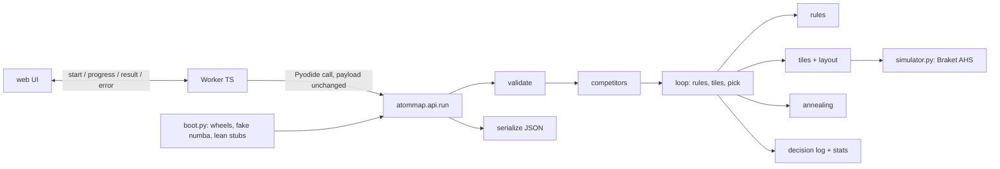
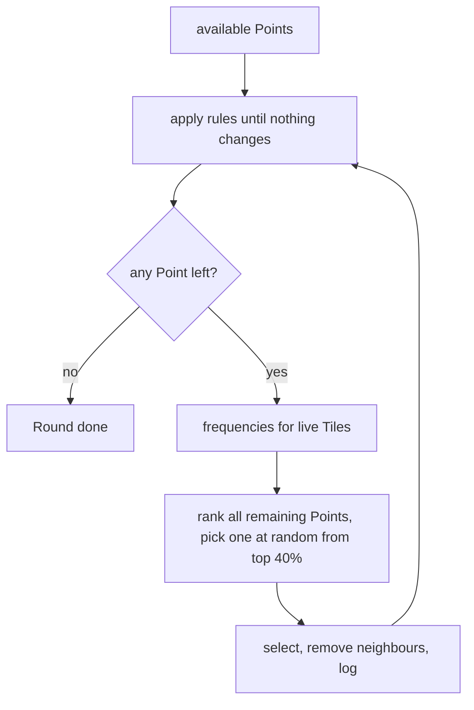

# Design Document

## Overview

The Engine is one Python package, `atommap` (`engine/src/atommap/`), that picks a large independent set of Points round by round with our own implementation of qReduMIS (Schuetz et al., Phys. Rev. Research 8, 033296 (2026), doi:10.1103/nh3b-1wv5). The quantum step is the Amazon Braket local AHS simulator. The same source files run in Pyodide 0.27.7 (inside a web worker) and natively under pytest.

The Worker (`worker/`) is a thin TypeScript wrapper. It loads Pyodide, installs the pinned wheels, imports `atommap`, and forwards messages unchanged. It holds no MIS logic.

Design decisions:
- **One entry point, JSON in and JSON out.** `atommap.api.run(request_json, emit)` returns a JSON string. This keeps the Worker free of logic and makes the round-trip requirement (9.7) testable natively.
- **Simulator behind a small interface.** Tests pass a fake Simulator for the hypothesis properties (Requirement 12) and use the real one only in slow tests.
- **Competitors share one loop.** Hybrid, Annealing_Rules and Coin_Flip_Rules differ only in the frequency provider, which guarantees identical rules and parameters (8.4).

## Architecture



Package layout (`engine/src/atommap/`):

| Module | Purpose |
|---|---|
| `boot.py` | Pyodide init: sha256 and version check of wheels, `micropip` with `deps=False`, fake numba, Lean_Mode import hook, warm-up simulation, progress events (Req. 1) |
| `api.py` | `run()`, input parsing, error mapping, JSON serialization (Req. 2, 9.5, 9.6) |
| `model.py` | Dataclasses: `Point`, `Request`, `Entry`, `Stats`, `Result` |
| `loop.py` | qReduMIS loop and round driver (Req. 3, 4) |
| `rules.py` | Classical_Rules: only the simplicial rule, named `simplicial` |
| `tiles.py` | Recursive bisection into Tiles of at most 10 Points (4.5) |
| `layout.py` | Scaled layout, push-apart, optimiser layout, split (Req. 6) |
| `simulator.py` | Pulse, program, seeding, shots, shot repair, cache (Req. 5) |
| `anneal.py` | Simulated annealing frequencies, see "Annealing" below (Req. 7.4, 8) |
| `competitors.py` | The four Competitors, Atoms_Alone (Req. 8) |
| `log.py` | Decision_Log and Stats (Req. 9, 10) |

Run flow for one Competitor and one Round:



Every iteration picks exactly one Point, so the loop ends. The Tiles are built once, after the first reduction of the Round, and only shrink afterwards (4.5).

## Components and Interfaces

### Worker message API

Messages are JSON objects with a `type` field. The Worker forwards payloads without modification.

| Direction | Message | Payload |
|---|---|---|
| UI to Worker | `start` | `{points:[{id,x,y}], mode, graph:{r, edges?}, seed}` |
| Worker to UI | `progress` (loading) | `{stage, percent}` |
| Worker to UI | `progress` (run) | `{competitor, round, step, tile}` |
| Worker to UI | `result` | the JSON result string of `run()` |
| Worker to UI | `error` | `{type, message, dependency?}` |

### Engine interfaces

```python
# api.py
def run(request_json: str, emit: Callable[[dict], None]) -> str: ...

# simulator.py
class Simulator(Protocol):
    def run_tile(self, positions_um: list[tuple[float, float]], seed: int) -> list[list[int]]:
        """100 shots; each shot is a list of post-sequence values, 0 means atom excited."""

class BraketSimulator: ...   # real local AHS simulator
def tile_frequencies(points, edges, sim, seed, cache) -> dict[str, float]: ...
def repair_shot(shot, edges, rng) -> set[str]: ...
def blockade_radius_m() -> float:  # (C6 / omega) ** (1/6)

# layout.py
def layout_tile(points, edges, r, seed=0, log=None, round=1) -> TileLayouts:  # parts (one Layout, or the Layouts of the split parts), splits, fallbacks
```

### Behaviour per area

- **Validation (Req. 2).** `api.run` checks, in this order: missing fields, Seed type, Mode, duplicate ids, unknown edge ids, self edges. Each error names every offending item. Edges are stored as a set of sorted pairs, so duplicates and reversed pairs collapse. With r alone, edges are all pairs with distance below r.
- **Rounds (Req. 3).** Channel_Plan runs 3 Rounds (channels 1, 6, 11). Place runs 1 Round. Each Round works on the Points not picked before. After Channel_Plan, unpicked Points go in the `five_ghz_only` list.
- **Loop (Req. 4).** Steps (a) to (d) as in 4.1. There is exactly one Classical_Rule, the simplicial rule: if all neighbours of a Point conflict with each other (they form a clique), pick the Point and remove its neighbours. An isolated Point is the easy case (no neighbours). No other rule is added, so the comparison with the paper stays valid. Each rule action logs one entry with the rule name `simplicial`. Ranking in step (c) breaks frequency ties by Point id, so it is deterministic. The frequency provider is atoms (Hybrid), annealing (Annealing_Rules) or none (Coin_Flip_Rules, which picks any remaining Point).
- **Simulator (Req. 5).** Constants: C6 = 5.42e-24 rad·m^6/s, omega = 15.8e6 rad/s, not overridable. The pulse lasts 4 µs. Amplitude ramps linearly from 0 over 0.25 µs, stays at omega until 3.75 µs, then ramps to 0 at 4 µs. Detuning is -5 omega until 0.25 µs, goes linearly to +5 omega at 3.75 µs, and stays there. Phase is 0 rad. The call uses 400 time steps and 100 shots. Before each call numpy is seeded from the Seed and a stable hash of the Tile's sorted Point ids. Post sequence 0 means excited, which means picked. Each shot is repaired by walking its picked Points in a seeded random order and dropping any Point that conflicts with one already kept. Frequency of a Point is the share of repaired shots that contain it. The cache key is the frozenset of the Tile's Point ids, and an entry is dropped when one of its Points is removed.
- **Layout (Req. 6).** Steps: scale coordinates so that r equals the blockade radius, push apart pairs closer than 4.15 µm, round to 0.1 µm, and check the 4.0 µm minimum spacing, the 100 µm box and the exact edge match (pairs at distance below the blockade radius equal the Tile's edges). If that fails, try an optimiser Layout (scipy) with the same checks. If that also fails, split the Tile into two by bisection and repeat on each part, logging a `split` entry and counting it. A single Point uses no atoms and has frequency 1.0, a classical value for the loop Competitors (Atoms_Alone runs it as one atom): picks made from it have the source `annealing` and are not atom-informed. There is no placeholder value.
- **Annealing (Req. 7.4, 8.4).** Used for Annealing_Rules and for the skipped-Tile fallback. Per Tile it draws 100 samples of 40 sweeps each. In sweep t (0 to 39) the temperature is T = 2.0 * (1 - t/40) + 0.05. The energy is -(number of picked Points) + 2 x (number of conflicting pairs among picked Points). Each sweep visits the Tile's Points in a seeded random order and flips each with the Metropolis rule. Each final sample is repaired exactly like an atom shot (`repair_shot`), and the frequency of a Point is the share of repaired samples that contain it.
- **Skipped Tiles (Req. 7).** A Simulator exception marks the Tile skipped: partial output is discarded, a `skip` entry is logged (Round, Point ids, exception text) and the skipped count goes up by 1. Annealing frequencies are used for that Tile in that step. A pick made from those frequencies has the source `annealing` in the Decision_Log and does not count toward Quantum_Share. Any other exception stops the run and becomes an `error` message with type and message and no partial result.
- **Competitors (Req. 8).** The four Competitors run on copies of the same input. Atoms_Alone skips rules: it splits Points into Tiles of at most 10 with the layout rule, keeps the biggest repaired shot per Tile, merges them, drops any Point that conflicts with an already kept Point, runs single-Point pieces on the Simulator as one atom so every pick comes from a Simulator run, and reports gaps (Points that could be added with no conflict). Its label is "atoms alone (in pieces of 10 or less in simulation)". A failing Competitor returns an error entry and the others still return.
- **Log and Stats (Req. 9, 10).** Stats are computed from the Decision_Log and counters of the run only. Quantum_Share is picks with source `atoms` divided by all picks. Only picks whose frequency came from a real Simulator run have source `atoms`, so they are exactly the atom-informed picks. The flag `atoms_not_needed` is true when that count is 0. The Stats always carry the splits, skipped Tiles and mismatches counts (mismatches is always 0). Every result has the Result_Label "simulation" and the paper citation in its metadata. No field claims a speed advantage.
- **Progress (Req. 9.9).** `emit` is called with `{competitor, round, step, tile}` before each Simulator call and after each pick.

## Data Models

```python
Point    = {id: str, x: float, y: float}                    # metres
Request  = {points: [Point], mode: "channel_plan"|"place",
            graph: {r: float, edges?: [[id, id]]}, seed: int}
Entry    = {round: int, source: "rule"|"atoms"|"annealing"|"coin flip",
            action: "pick"|"remove"|"split"|"skip",
            points: [id], rule?: "simplicial", reason?: str, message?: str}
Stats    = {picks_per_round: [int], picks_per_source: {str:int},
            quantum_share: float, atoms_not_needed: bool,
            splits: int, skipped_tiles: int, mismatches: int,
            braket_calls: int, cache_hits: int, layout_fallbacks: int,
            timings: {...}, gaps?: [id]}                      # gaps only for Atoms_Alone
Round    = {channel: 1|6|11|null, picks: [id]}
CompetitorResult = {name, label: "simulation", rounds: [Round],
            five_ghz_only?: [id], decision_log: [Entry], stats: Stats}
Result   = {meta: {citation, label: "simulation"},
            competitors: {name: CompetitorResult | {error: str}}}
```

`round` in an Entry is the channel (1, 6, 11) for Channel_Plan and 1 for Place. Entry order is the order of decisions across all Rounds. The result serializes with `json.dumps` using only JSON types, and an unserializable field produces an error naming that field.

## Correctness Properties

*A property is a characteristic or behavior that should hold true across all valid executions of a system-essentially, a formal statement about what the system should do. Properties serve as the bridge between human-readable specifications and machine-verifiable correctness guarantees.*

### Property 1: Rounds are disjoint independent sets that partition the Points

*For any* valid request and any Competitor, each Round's picks contain no two Points joined by an edge, no Point is in more than one Round, and in Channel_Plan the picked Points plus the `five_ghz_only` Points equal the input Points with no overlap.

**Validates: Requirements 3.3, 3.4, 3.5, 3.6**

### Property 2: Rounds are maximal

*For any* valid request and any Competitor except Atoms_Alone (including runs where the Simulator fails for some or all Tiles), no Point available to a Round and not picked in it can be added without a conflict.

**Validates: Requirements 3.7, 7.4, 7.5**

### Property 3: Decision_Log replay equals the picks

*For any* valid request and any Competitor, replaying the `pick` entries of each Round in order gives exactly that Round's picks with no repeated id, every entry has a valid round, source and action and only request ids, and every `rule` entry has the rule name `simplicial`.

**Validates: Requirements 4.2, 4.3, 4.4, 9.2, 9.3, 9.4, 9.8**

### Property 4: Stats agree with the Decision_Log

*For any* valid request and any Competitor, the Stats picks per Round and per source, Quantum_Share, `atoms_not_needed`, splits and skipped Tiles equal the values recomputed from the Decision_Log, and mismatches is 0.

**Validates: Requirements 6.11, 7.3, 10.1, 10.2, 10.3, 10.7, 10.9**

### Property 5: Same input and Seed give identical results

*For any* valid request, running it twice with the same Seed gives identical serialized results, with the cache enabled or cleared, and the four Competitors leave the input unchanged.

**Validates: Requirements 5.4, 8.1, 8.5, 11.1, 12.4**

### Property 6: Accepted Layouts are valid

*For any* Tile of 1 to 10 nodes, every accepted Layout has all atom pairs at least 4.0 µm apart after rounding to 0.1 µm, fits in a 100 µm box, and has pairs at distance below the blockade radius equal to the Tile's edges.

**Validates: Requirements 6.1, 6.2, 6.3, 6.8, 12.5**

### Property 7: Tiles and splits partition the Points

*For any* remaining graph, the Tiles have at most 10 Points each and every Point is in exactly one Tile, and a Tile that cannot be laid out is split into parts that each hold a disjoint share of its vertices and together hold all of them.

**Validates: Requirements 4.5, 6.9**

### Property 8: Repaired shots are independent sets

*For any* graph and any shot, the repaired shot is an independent set that is a subset of the shot's excited Points, and every frequency is between 0 and 1.

**Validates: Requirements 5.7**

### Property 9: Invalid requests are rejected with named items

*For any* request with missing fields, a non-integer Seed, an unknown Mode, duplicate ids, unknown edge ids or self edges, `run` returns an error that names every offending item and no picks.

**Validates: Requirements 2.3, 2.4, 2.5, 2.6, 2.7, 2.8**

### Property 10: Duplicate edges do not change the result

*For any* valid request, repeating edges or adding them in reverse order gives the same result as the request with each edge once.

**Validates: Requirements 2.10**

### Property 11: Result JSON round trip

*For any* valid result, parsing the serialized text with a standard JSON parser and serializing it again gives an equal result.

**Validates: Requirements 9.5, 9.7**

### Property 12: Atoms_Alone is independent and reports its gaps exactly

*For any* valid request, the Atoms_Alone picks in each Round are an independent set, and the reported gaps equal the Points not picked that have no picked neighbour.

**Validates: Requirements 8.2, 8.3**

### Property 13: The simplicial rule is safe

*For any* graph of up to 14 Points, applying the simplicial rule exhaustively and then solving the rest by brute force, then adding the picked Points, gives the same maximum independent set size as brute force alone.

**Validates: Requirements 4.1, 4.2, 12.2**

## Error Handling

| Case | Behaviour |
|---|---|
| Missing, wrong-hash or wrong-version wheel | Abort init, `error` message naming the dependency, no partial Engine state (1.7) |
| Invalid request | Error naming the items, no picks (2.3 to 2.8) |
| Simulator exception on a Tile | Skip the Tile, log `skip`, use annealing frequencies (7.1 to 7.5) |
| Layout cannot be matched | Split the Tile, log `split` (6.5 to 6.9) |
| One Competitor fails | Error entry for it, others still returned (8.6) |
| Any other exception in a run | Stop, `error` with type and message, no partial result (7.6) |
| Unserializable field | Error naming the field, no partial result (9.6) |
| Missing test setting (seed, map size, run count) | Abort, no reported numbers (12.7) |
| `OPENBLAS_NUM_THREADS` not 1 | `conftest.py` fails the test run before any test (11.3) |

## Testing Strategy

Property-based testing applies because the Engine is pure graph logic with a large input space. The Worker wiring, Pyodide loading and wheel installation are infrastructure and get smoke and integration tests instead.

**Property tests** use `hypothesis` with pytest. The hypothesis graph generators produce disk graphs and also non-disk graphs (a disk graph with random edges added or removed, like walls or walking distance). Each of Properties 1 to 13 is one test with at least 100 examples, using a fake Simulator (a seeded function returning random shots, with an option to raise for chosen Tiles). Each test carries a comment in the form `Feature: engine, Property N: <title>`. Tests that call the real Braket Simulator are marked `slow` and use at most 20 examples (12.10).

**Unit and example tests:**
- Pulse program and constants: 400 steps, 100 shots, timings, blockade radius value (5.1 to 5.3, 5.5).
- Cache: the same Tile twice makes one Simulator call, and removing a Point invalidates its Tile (5.8).
- Single-Point Tile gives frequency 1.0 with no atoms (6.7). No placeholder values (6.10).
- Zero Points gives the right number of empty Rounds for each Mode (2.9, 3.9). Round count and channels (3.1, 3.2).
- Competitor failure leaves the others intact, and logs and Stats are separate (8.6, 8.7, 8.8).
- Labels, citation metadata and the absence of speed claims (4.6, 10.4 to 10.6). Progress events (9.9).
- Fake numba and Lean_Mode stubs (1.9, 1.10). Package file hashes equal in both environments (1.3).
- Fixtures: Hero map runs a full Channel_Plan run, and the sparse control gives Quantum_Share 0 with the flag set (12.8, 12.9).

**Integration and smoke (browser):** init time, download and memory limits, warm Hero run under 20 seconds, no PyPI requests, wheel failure messages (1.2, 1.5 to 1.8, 1.11 to 1.15).

**Determinism setup:** `conftest.py` requires `OPENBLAS_NUM_THREADS=1` and reads seeds, map sizes and run counts from a committed settings file with no overrides (11.2, 11.3, 12.6, 12.7).
