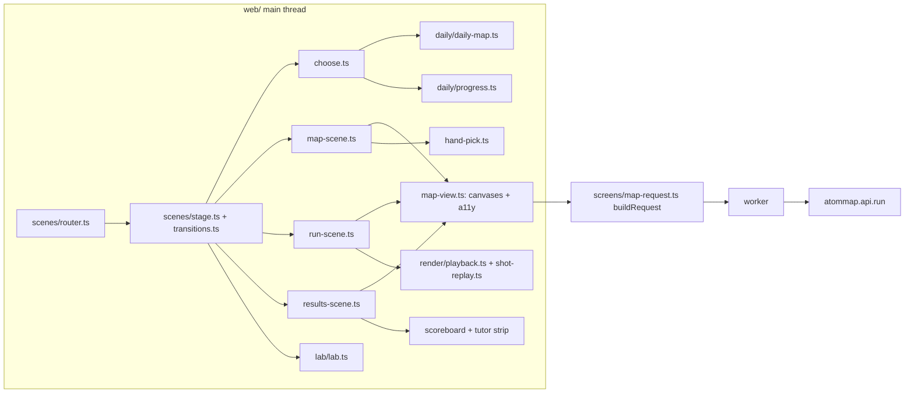

# Design Document

## Overview

The experience spec rearranges the existing app into four Scenes, adds two Engine additions (a Shots_Event and optional Lab_Settings), a run animation that replays the real shots, a Hand_Pick mode, a Daily_Map with Local_Progress, the two US_Maps and a Lab.

Design decisions:

- **Scenes 2 to 4 share one map.** The Map_Scene, Run_Scene and Results_Scene have the same layout: the Scene_Steps on top, the map on the left and a side panel on the right. The map element (static canvas, dynamic canvas, accessible Point list) is created once per map and moved between these Scenes, not rebuilt. Only the side panel and the overlays change. This keeps the canvas state, gives the Container_Transform a fixed target and avoids redrawing thousands of street segments on every Scene change.
- **One router, one stage.** `scenes/router.ts` turns the hash into a route object and back (pure functions). `scenes/stage.ts` owns the current Scene, runs the transitions and blocks input while one runs. `main.ts` keeps the `#/results` route for the Results_Page.
- **Animation from events only.** The Shots_Event is the only new data the animation needs. Everything on screen during a run comes from `simulate`, `frequencies`, `shots` and `pick` events. Playback stays a pure reducer, which now also expands a Shots_Event into replay steps.
- **The Engine changes are additive.** Without `settings` and with emit off, the Engine's result text does not change. The Shots_Event comes from the repaired shots the Engine already computes for the frequencies.
- **Pure logic in small modules.** Routes, Hand_Pick stats, Daily_Map, Local_Progress, Run_Numbers and the replay reducer are pure functions with property tests. The DOM code only calls them.
- **The Lab is a separate overlay route.** It reuses the worker, `buildRequest` and the Scoreboard model, and adds nothing to the normal visit unless it is opened. It is built after the main flow and before the optional UI property tests. If time runs short, "Download run log" is cut first, then the experiment cards.
- **The simulator loads in the background.** The Choose_Scene shows at once. The run button shows the loading progress and waits for the Worker. Hand_Pick works during the wait.

## Architecture



New or changed files in `web/src/`:

| Path | Purpose |
|---|---|
| `scenes/router.ts` | `parseRoute(hash)`, `formatRoute(route)`, route types. Pure |
| `scenes/stage.ts`, `scenes/transitions.ts` | The app bar with the Scene_Steps, mounting Scenes, the exit and enter animations, the Container_Transform, the input lock |
| `scenes/choose.ts` | The Choose_Scene and its Map_Cards |
| `scenes/card-preview.ts` | Draws a small preview of a map's Points and edges |
| `scenes/maps.ts` | The list of maps (name, title, chip kind, preview loader) and the chip state shared by the cards and the Map_Scene |
| `screens/map.ts` | The shared map of Scenes 2 to 4 and their panels: the side panel of the Map_Scene, the run bar and Scoreboard of the Run_Scene, the Tutor, Scoreboard and legend of the Results_Scene |
| `hand-pick.ts` | Valid_Picks, Clashes and Free_Points. Pure |
| `run-number.ts` | Random Run_Numbers, the Daily_Seed. Pure apart from `crypto.getRandomValues` |
| `daily/daily-map.ts` | Builds the Daily_Map from a Daily_Seed. Pure |
| `daily/progress.ts` | Local_Progress with a storage argument. Pure apart from the storage it is given |
| `render/shot-replay.ts` | Expands a Shots_Event into replay steps and folds them. Pure |
| `render/atoms-layer.ts` | Draws Atoms, Blockade_Halos, the Laser_Sweep and flashes on the dynamic canvas |
| `render/histogram.ts` | The Shot_Histogram (DOM, with a text alternative) |
| `data/map-checks.json` | The committed Map_Checks of the US_Maps |
| `answer.ts` | The Answer_Box texts and the Answer_Set from the run. Pure |
| `lab/lab.ts`, `lab/entrance.ts`, `lab/history.ts`, `lab/experiments.ts`, `lab/icons.ts` | The Lab |

`screens/map.ts` stays one module (built in task 6.4): it already owned the canvases, the a11y list, `layout()`, the run and the Scoreboard, all closely tied. It now makes its map element once and arranges the panels of Scenes 2 to 4 around it, reports each scene change before and after it (`sceneWillChange`, `sceneDidChange`), and offers `select(slug)`, `stopRun()`, `heading()` and `parts(scene)` to the stage. Its old toolbar moved into the Map_Scene side panel; the mode radios are gone (the Choose_Scene chooses the map). `screens/map-request.ts` keeps `buildRequest` as the only place that builds requests, with one new optional argument for Lab_Settings.

## Components and Interfaces

### Routes

```ts
type Route =
  | { scene: "choose" }
  | { scene: "map" | "run" | "results" | "lab"; map: MapSlug }
  | { scene: "measured" };            // the existing #/results page

parseRoute("#/map/hall/run")  -> { scene: "run", map: "hall" }
formatRoute({ scene: "map", map: "sf-bus" }) -> "#/map/sf-bus"
```

Slugs: `hall`, `kadikoy`, `sf-bus`, `nyc-bike`, `your-map`, `today`. An unknown slug or scene gives `{ scene: "choose" }`. Routes are the only state in the URL. Map choices, Hand_Picks and runs live in memory, so a reload starts a fresh visit (Requirement 1.4 sends a stale run or results route to the Map_Scene).

`stage.ts` listens to `hashchange`. A route change while a transition runs is queued and applied when it ends (only the latest one). Leaving `run` through back stops the run in the worker as the ui spec's stop does now.

### Transitions

`transitions.ts` uses the Web Animations API (`element.animate`), no library.

| Move | Animation |
|---|---|
| Exit | the Scene root: opacity 1 to 0, scale 1 to 0.98, blur 0 to 4 px, 260 ms, ease-in |
| Enter | each element with `data-enter` in document order: opacity 0 to 1 and translateY 14 px to 0, 460 ms, delay 60 ms × index, `cubic-bezier(0.22, 1, 0.36, 1)` (ease-out, no overshoot) |
| Container_Transform | FLIP: measure the Card_Preview box and the map box, place a fixed-position copy of the preview over the card, animate its left, top, width and height to the map box in 520 ms with the same ease-out, then show the real map and remove the copy |

While any animation runs, `stage.locked` is true, a transparent overlay takes pointer events, and the keydown handler of the Stage ignores Enter, Space and the run shortcuts. The lock ends when every animation's `finished` promise settles, or after 1.2 s as a guard. With `prefers-reduced-motion: reduce`, `transitions.ts` skips all animations and swaps at once. Every animation ends at the element's CSS state (`fill: "backwards"` only holds the first frame during a delay), so the final layout equals the layout without motion (Requirement 4.6).

Outgoing parts are animated as snapshots: a copy of each part is laid over it (fixed position, inside `display: contents` copies of its ancestors so the CSS rules still match, canvases copied), the real DOM changes at once, and the copy fades out. So no state change waits for an exit animation, and a run starts the moment Run is pressed. Inside the map flow (Map_Scene, Run_Scene, Results_Scene) the map stays put: only the parts that differ between the two scenes go out and come in. The Container_Transform copy is a panel box holding the preview as an image with `object-fit: contain`, so the points never stretch while it grows.

The back button during a run stops it. The worker cannot stop a run halfway, so it finishes the dropped run; the client drops every message of that run, and a run started meanwhile waits until the dropped one has ended. The status line then says "Finishing the run you stopped first. Your run starts right after it."

### Loading in the background

The Loading_Screen of the ui spec is no longer shown in the normal flow. `main.ts` mounts the Stage and shows the Choose_Scene at once, and starts the Worker at the same moment. The cards need only the fixtures, which are plain same-origin JSON files, so they do not wait for the Worker.

`state.ts` keeps the loading state as now (`loadPercent`, `loadStage`, `loadError`) and adds `ready: boolean`. The Map_Scene's run button reads it:

| State | Run button | Hint |
|---|---|---|
| loading | disabled, "Getting the simulator ready… 42%", the stage sentence of the old Loading_Screen under it (for example "loading a quantum simulator into your browser"), a thin progress bar inside the button | "Try it by hand while the simulator gets ready." |
| ready | enabled, "Run" | none; the live region says "The simulator is ready." once |
| error | disabled, "The simulator could not load" | the plain-words error of the old Loading_Screen |

The stage sentences and the error text come from `screens/loading.ts`, which keeps its pure parts (stage to sentence) and loses its screen. Hand_Pick, the Card_Previews, Your_Map editing and the Results_Page work in every state. A run route opened before `ready` shows the Map_Scene (Requirement 1.4).

### Choose_Scene and Map_Cards

`scenes/maps.ts` lists the maps in this order: wifi hall, Kadıköy cafés, San Francisco bus stops (Mission), New York bike-share stations (Greenwich Village), Your map, Today's map. Each entry has a slug, name, description, chip set and a loader that returns the Points and edges for a chip state.

Each Map_Card is a `<article>` with a heading, a description, a Card_Preview `<canvas>` (about 220 × 130 CSS px), its Card_Chips as small radio groups or a number input, and, for the US_Maps and the Daily_Map, a note line. The card body is one `<button>` covering the card except the chips, so a click or Enter on it opens the Map_Scene, and the chips stay separate controls (Requirement 2.5, 2.6). Its accessible name is "Open <name>, <N> points".

Card_Preview draws the edges and Points only (no streets, no walls), with `fitView` of the static layer, one batched path. Fixtures are loaded once and cached. The place fixtures are large, so the previews of Kadıköy and the US_Maps draw after their fixture loads. Until then the card shows "Loading the map…" in the preview box. The chip state of each map is kept in memory and passed to the Map_Scene.

Layout: at 1366 × 768 the cards sit in a 3 × 2 grid under the title. At 375 px they are one column and the Stage scrolls inside its own box (the page itself does not scroll sideways).

### Map_Scene

Side panel: the map's title (the scene heading), the label line, the distance toggle (kept in sync with the Card_Chip), the three How_To_Read items (inline SVG icons: a dot, two dots with a line, an atom with a play mark), the Hand_Pick readout and "Clear my picks", the run button and, for the US_Maps, the story line and the note of Requirement 13.4. Place maps keep their attribution line from the ui spec.

On Your map the "Points as text" panel is folded into a `<details>` element (closed by default, its summary is a keyboard control), and on a laptop the side panel scrolls inside its own box rather than make the page taller than the window. The Tutor's idle text is no longer shown (Requirement 3.3). `buildIdle` stays in `sentences.ts` for its tests and is not called by the Map_Scene.

### Run_Numbers

```ts
randomRunNumber(): number              // 1..9999 from crypto.getRandomValues
dailySeed(date: Date): number          // UTC YYYYMMDD, e.g. 20261204
```

The Results_Scene shows "Run #N" and two controls: "Repeat this run" (same N, map, chips and settings) and "Run again" (a new N). On the Daily_Map "Run again" is hidden. The Scoreboard's seed input and run-again form move out of the Scoreboard into the Results_Scene panel. The Lab has the only seed input (Requirement 5.6).

### Engine: Shots_Event

`simulator.part_frequencies` already loops over the shots and repairs each one with the Tile's seeded rng. It becomes:

```python
def part_shots(simulator, layout, edges, seed, shots=SHOTS) -> tuple[dict[str, float], list[list[int]]]:
    """Frequencies and, per shot, the indexes (into layout.ids) of the Points kept after repair."""

def part_frequencies(...) -> dict[str, float]:
    return part_shots(...)[0]          # unchanged result, same rng calls
```

`FrequencyCache.part_frequencies` stores the kept lists of the latest real call in `last_kept` (next to `last_shots`). In `loop.py`, right after the `frequencies` event:

```python
emit({"kind": "shots", "round": round, "step": step,
      "tile": list(part.ids), "kept": cache.last_kept})
```

`atoms_alone.py` computes its event frequencies in `_shot_frequencies` with its own rng. It returns the kept lists from the same loop and emits a `shots` event with them. No other rng call is added. `api.py` documents the new kind. The emit wrapper adds `type` and `competitor` as for the other kinds.

Size: a hero run has a few hundred Simulator calls, each at most 100 shots × at most 10 indexes, so well under 1 MB of messages per run.

### Engine: Lab_Settings

`model.validate_request` reads an optional `settings` object:

```python
@dataclass(frozen=True)
class Settings:
    shots: int = SHOTS          # 10..200
    top_share: float = TOP_SHARE   # 0.1..1.0

Request.settings: Settings | None   # None when absent, so a request without it runs exactly the old path
```

Errors are ValidationErrors with kind `invalid_settings` and messages such as "settings.shots must be an integer from 10 to 200, got 5" or "settings has an unknown key: steps. Allowed keys: shots, top_share". A boolean is not an integer.

Plumbing:

- `Simulator.run_tile(positions_um, seed, shots=SHOTS)`: the Braket simulator passes `shots` to `run`, and the test fake draws `shots` rows. The default keeps every existing call the same.
- When the request has `settings`, `run_competitors` wraps the Simulator once (`_ShotsSimulator`), so every call of the run, in the loop and in Atoms_Alone, asks for `settings.shots`. Without `settings` nothing is wrapped and every call is the old two-argument call. `settings.top_share` goes to `run_round` (Hybrid, Annealing_Rules, Coin_Flip_Rules). `top_group_size(n, share)` keeps `max(1, round(share * n))`. Coin_Flip_Rules has no ranking and picks among all remaining Points, so the share does not change it.
- The result text does not echo `settings`, so a request with the default `settings` gives the same text as one without (Property 3). The UI knows its own request and shows the Lab_Label from it.

`web/scripts/record-results.mjs` and `measure-limit.mjs` stop with a message when a request has `settings` (Requirement 17.6). `record-results.mjs` gets a `--check` flag that makes the 30 measured runs again and compares them with `results.json` without writing, to show that they still reproduce.

### Run animation

Playback (`render/playback.ts`) keeps its buffer, rAF loop and pure reducer. New pieces:

- **Replay steps.** When the reducer meets a `shots` event of the Hybrid, `shot-replay.ts` turns it into steps `{kind: "shot", tile, kept, index}` for index 0..n-1, queued before the next event. The speed control sets how many replay steps are due per frame (the default plays 100 shots in about 1.5 s). Skip applies all remaining steps without drawing.
- **Fold.** `foldShots(tile, keptLists, upTo)` gives each Point's count and glow `count / upTo`. After the last step this equals the `frequencies` event exactly, because both come from the same kept lists (Property 7). The reducer sets the glow target from the fold, not from the `frequencies` event, during a replay. When there is no `shots` event for a Group (cache hit), the `frequencies` event sets the glow at once and the status line says "results reused from an earlier step".
- **Atoms layer.** `render/atoms-layer.ts` draws on the dynamic canvas, for the current Group only: each Atom as a filled sphere sprite (teal, from the glow sprites) with a thin ring, its Blockade_Halo as a dashed circle of radius `(r / 2) × view.scale` (dashed so it is not colour alone), the Laser_Sweep as a soft vertical band moving left to right across the Group's bounding box during the time from the `simulate` event to the first replay step (at most 600 ms), and the flash of the Atoms kept in the current shot as a short brightening of their sphere (one frame of full glow, then back to the fold value).
- **Collapse.** An atom pick draws a pulse ring that shrinks into the locked shape (300 ms), and the `removed` neighbours fade (ui spec). A rule pick keeps the short pulse of the ui spec.
- **Histogram.** `render/histogram.ts` is a small DOM panel in the Run_Scene side panel: one bar per Atom (at most 10) with its id and "k of n", updated once per frame. It has `role="img"` and an `aria-label` that is updated at the end of each replay ("p03 kept in 52 of 100 shots, ...").
- **Reduced motion.** No sweep, no flashes, no pulse, no fade. Each Group shows its Atoms, halos, final glow and histogram at once, and the reduced-motion "next step" control of the ui spec moves through the steps.
- **Honesty.** The layer draws a halo only for Points of the current Group, flashes only Points listed in the current replay step, and never draws a glow that is not the fold or a `frequencies` value (Requirement 7.6). Steering rule of Requirement 20.

### Hand_Pick

```ts
interface HandPickStats { valid: number; clashes: [string, string][]; free: number; freeIds: string[] }
handPickStats(ids: string[], edges: [string, string][], picked: ReadonlySet<string>): HandPickStats
```

- `clashes`: the edges with both ends picked, sorted.
- `valid`: picked Points in no clash.
- `free`: Points not picked with no edge to any picked Point (Glossary). The hint counts each such Point alone. It is the number of single Points that fit now, not a promise of how many fit together.

The Map_Scene keeps one `Set` per map and distance setting. A click on the dynamic canvas uses `nearestPoint` (12 px) as now. On Your_Map an "Edit points / Pick points" toggle chooses whether a click edits the map or the Hand_Pick. Drawing: a picked Point gets a filled diamond; a Point in a clash gets a red diamond with a cross, and the clash edge is drawn red and dashed. The edges come from the same `buildRequest` edges as the run (Requirement 9.7).

You_Line: `You: ${valid}` plus ` (${clashes.length} clashes not counted)` when there are clashes. It sits under the four cards in the Scoreboard column, in the muted text colour, in a box without a border, so it never looks like a fifth card or a winner.

### Answer_Box

`answer.ts` is pure: `buildAnswer(input)` gets the mode, the map's words, the Point ids (and names on place maps), the edges of the run request, `result.competitors`, the Valid_Picks of the Hand_Pick (null on the channel plan or without one) and the Lab_Label, and returns every text of the box and the Answer_Set by Round. `whichLine(answer, id)` gives the line for a clicked Point and the ids to ring.

- Each finished plan's sets are read from `rounds[].picks` and checked: no edge of the request inside one Round's set, no Point in two Rounds, the count equal to `stats.total_picks`. A plan that fails is named with its reason and not counted.
- N is the largest count of a passing plan. The plan shown is the Hybrid when it found N, else the first in card order. The Hand_Pick takes its place only with strictly more Valid_Picks, and never on the channel plan (one set, not three channels).
- Maximality is checked on the Answer_Set: every other Point has an edge into it (channel plan: into each Round's set). Only then the "Every other one ..." line and "Click a point to see which." are shown.
- Words per map (`<noun>`, `<pair>`, `<near>`): Kadıköy "cafés", "within a 150 m walk", "within a 150 m walk of" (straight line: "closer than 150 m", "closer than 150 m to"); the US_Maps "bus stops" and "stations" with r from the fixture; Your_Map and the Daily_Map "points", "closer than r m".
- The box sits under the map, above "One run proves nothing." The map's height already takes the room under it into account, so the box makes the map shorter and the scene still fits 1366 x 768. "Show the list" is a `<details>` with a scrolling list of at most about four lines; opening it lays the map out again.
- "Show them on the map" calls the Plan_Selector (`scoreboard.selectPlan`), so the map, the legend, the Tutor's plan line and the exports all follow, as for a click on the card. For a Hand_Pick answer it draws the Valid_Picks as diamonds on the final map; the exports stay with the plans.
- A click or Enter on a Point after a finished run keeps the Tutor's "why" as before and also writes the box's which line. The box rings the neighbours only while the map shows a plan other than the Hybrid, so it never draws over the Tutor's own ring.
- The Lab_Label comes in through the input; until the Lab exists (task 14) it is always null.
### Daily_Map

`buildDailyMap(seed)` with `mulberry32(seed)` (already in `your-map/editor.ts`):

- Area 120 × 80 m, r = 10 m, straight-line edges, Place mode, one Round.
- The area is cut into 4 × 3 slots of 30 × 26.7 m. A component is placed in a slot so that its bounding box keeps at least r/2 from the slot border. Two components are then at least r apart, so no edge joins them. The largest box that fits is 20 × 16.7 m.
- Component kinds, sized to fit that box: a **chain** of 3 or 4 Points in a zigzag (step 7.5 m, turn angle 100°, so second neighbours are 11.5 m apart, more than r; 4 Points span about 17 × 5 m); a **ring** of 5 Points (radius 6.8 m) or 6 Points (radius 8 m), both with an 8 m chord, so the next-but-one Points are 12.9 m and 13.9 m apart; a **square** of 4 Points with an 8 m side (diagonal 11.3 m, more than r); a **single** Point.
- **The Tangled_Cluster.** Separate chains, rings and squares are too easy: one pick on a ring leaves a path that the rules finish at the maximum, so every plan, even coin flip + rules, gets the maximum and all four tie every day. So each Daily_Map also has exactly one Tangled_Cluster of 8 to 12 Points in two neighbouring slots of one row (60 × 26.7 m, so its box is up to 50 × 16.7 m). Its Points are drawn uniformly in that box, at least 4 m apart (so they do not overlap on screen). A draw is kept only when the cluster is connected and the Rule_Pick_Process can reach at least two different final counts on it (below). Otherwise the generator draws again, up to 400 times, and then falls back to one fixed hand-made cluster that meets the same test.
- **Rule_Pick_Process check (`reachableCounts`).** On at most 12 Points the check is exact. A state is the set of Points left (a 12-bit mask). In each state the simplicial rule is applied until it stops, in the Engine's scan order (request order, restart after each action). Then the check branches over every Point left as the next non-rule pick. With memo on the mask, there are at most 4096 states. The result is the set of final counts any loop-based plan could reach, whatever its non-rule picks. The cluster needs at least two values in that set. That says the order of picks can change the count. It does not say that the plans will differ on a given day, and no text says so (Requirement 11.8).
- At least one chain, at least one ring or square, and the one Tangled_Cluster. The other ten slots get chains, rings, squares and singles, drawn from the generator until the total is 30 to 40. Each component gets a random rotation, redrawn until its box fits (rotation 0 after 8 tries). Then the slot order is shuffled (the cluster keeps two neighbouring slots), and empty slots stay empty.
- Ids `d01`, `d02`, ... in slot order. The result: `{ seed, r, points, edges, area, parts }`, where `parts` lists each component's kind and ids (for the tests).

Why this meets Requirements 11.3 and 11.7: a chain's end Point has one neighbour, so it is simplicial and the rules solve the chain. In a ring or square of 4 or more Points every Point has two neighbours that are not joined, so no Point is simplicial and the rules alone cannot finish it (the Classical_Rules are the single simplicial rule, `rules.py`). The Tangled_Cluster passes `reachableCounts` by construction. The test checks all of this on the graph for every date of a year.

The Daily_Map is a map entry with slug `today`. Its Run_Number is `dailySeed(today)`. "Today" is read once when the Choose_Scene opens. A visitor who stays past midnight UTC keeps that map until the next Choose_Scene.

### Local_Progress

```ts
interface Progress { v: 1; days: Record<string /* YYYY-MM-DD */, { best: number }> }
loadProgress(storage: Storage | null): Progress            // empty on any error or wrong shape
recordDaily(p: Progress, date: string, valid: number): Progress  // played, best = max
streak(p: Progress, today: string): number                 // consecutive days ending today or yesterday
saveProgress(storage: Storage | null, p: Progress): void   // try/catch, keeps the last 60 dates
```

Key `atommap.progress.v1`. `window.localStorage` itself is read in a try/catch, because some browsers throw on access. A shape check accepts only `{v: 1, days: {date: {best: integer >= 0}}}`. Anything else is treated as empty and replaced on the next save. Nothing is sent anywhere (Requirement 12.4). The streak counts a day as played when it has an entry. It counts back from today, or from yesterday when today is not played yet, so the card can say "3-day streak, play today to keep it".

### US_Maps and Map_Checks

`settings.ts` `PLACES` gets the two US_Maps with their display names. The fixture loader reads `r` from the fixture (150, 244 or 305) and checks `kind`, `story` and `names` or `merge` when present. `buildRequest` sends `graph: {r: fixture.r, edges}` for walking and `graph: {r: fixture.r}` for straight line. Export file names use the slugs `sf-bus` and `nyc-bike`.

`web/scripts/check-maps.mjs` (`npm run check-maps`, run by hand) runs seeds 1, 2 and 3 of each US_Map in the built site with the app's `buildRequest`. It writes `web/src/data/map-checks.json`:

```json
{ "date": "...", "commit": "...", "chromium": "...",
  "maps": { "sf_bus_stops": { "fixture": {"osm_data_timestamp": "...", "points": 55, "walking_edges": 70},
                              "runs": [{"seed": 1, "seconds": 4.1, "quantum_share": {"Hybrid": 0, ...}, "ok": true}, ...] } } }
```

Every run goes into the file, also a failed or slow one, and no run is repeated. The owner runs the script again after each new fetch of a US fixture.

The same script makes the **Daily_Check**: for each fixed date 2026-12-01 to 2026-12-10 (fixed in the script before measuring) it builds the Daily_Map with the app's own `buildDailyMap` and `buildRequest`, runs it once with its Daily_Seed, and writes a `daily` entry: `{date, seed, points, edges, seconds, ok, totals: {...}}`. A run over 60 s is written with `"over_limit": true`, and the script prints a plain line about it and changes nothing. The Daily_Map is not changed automatically. The owner and the developer look at the numbers first (Requirement 11.9). The Daily_Check does not gate the Daily_Map card in the app.

The app imports this file at build time. A US_Map is listed only when its entry exists, matches the loaded fixture (`osm_data_timestamp`, point and edge counts) and has three ok runs of 60 s or less (Requirement 13.6). The "atoms not needed here" note is shown only when all three runs have a Hybrid Quantum_Share of 0 (Requirement 13.5). Its text: "In our runs on this map the rules made every pick, so the atoms were not needed. The stops line up along the streets, and the rules solve such chains on their own." ("stations" for the bike map). The Results_Page gets one sentence under its protocol: "The measured protocol covers the wifi hall, the sparse wifi hall and Kadıköy only." (Requirement 13.7).

### Lab

Route `#/map/<map>/lab`, reachable from the Results_Scene's "Open the lab" button.

**Entrance** (`lab/entrance.ts`, about 1 s, Web Animations API): a full-screen layer fades to the lab background (`#07080f`) in 200 ms. An inline SVG Erlenmeyer flask (accent purple `#7f77dd` stroke, 1.5 px) draws its outline with a stroke-dash animation (300 ms). The teal (`#5dcaa5`) liquid rises by scaling a clipped rectangle from the bottom (300 ms). Three teal bubbles (circles) float up and fade (400 ms, 80 ms apart). The text "ENTERING THE LAB" (monospace, letter-spaced) fades in and rises 6 px (300 ms, starting at 600 ms). Then the entrance layer fades out while the lab panels enter with the Scene enter animation. Reduced motion: no entrance, the Lab appears at once.

**Layout:** a top bar (flask icon, "ATOMMAP LAB · <map name> · RUN <n>", "Lab settings, not the measured defaults.", "Leave the lab"), then three columns at 1366 px: instruments (controls and experiments) 22 rem, the map in the middle (the same map view), readouts and history 24 rem. One column at 60 rem or narrower. The background has a faint grid: a CSS background of two 1 px line patterns every 24 px at about 6% opacity. Labels and readouts use `ui-monospace, SFMono-Regular, Menlo, Consolas, monospace` (system fonts only). Panels use the panel colour, one shade darker in the Lab.

**Icons** (`lab/icons.ts`): four small line icons (flask, sliders, test tubes, gauge), drawn by hand as inline SVG `<path>`s, 16 × 16, stroke `currentColor`, used in the button and the panel titles. No icon set is copied, so no licence file is needed. If a set is used later, its licence goes into `docs/` with a note in the README.

**Controls** (`lab/lab.ts`), each with one line of instruction:

| Control | Range | Instruction |
|---|---|---|
| Seed | integer | "Same number, same result." |
| r (metres) | 2 to 400 | "How close is too close. A bigger r draws more lines." Read-only on walking maps, with "Walking distances were measured on the streets for r = N m. Switch to straight line to change it." |
| Shots per group | 10 to 200, default 100 | "How many times each group is simulated. Fewer shots, noisier advice." |
| Top group | 10% to 100%, default 40% | "The share of best-lit points the next pick is drawn from." |

"Run again" builds the request with `buildRequest(choice, seed, { shots, top_share })`. Errors are shown next to the control (Requirement 16.2).

**Experiments** (`lab/experiments.ts`): five cards (seed, 10 shots, top group 100%, top group 10%, bigger r), each with "Try: ..." and "Look for: ...", and a "Set it up" button that fills the controls (Requirement 16.5).

**History** (`lab/history.ts`): an in-memory array of `{runNumber, r, shots, topShare, totals, hybridShare}` for this visit, shown as a table with column headers and a caption.

**Export:** "Copy request" writes the exact JSON text sent to the worker with `navigator.clipboard.writeText` (with a text-area fallback). "Download run log" saves `{request, events, result}` as `atommap-<map>-run<n>-log.json`.

**For developers:** a short box with three lines of Python (`from atommap import api`, `print(api.run(request_json))`) and a link to the README section "Build on AtomMap".

**Labels:** a Lab_Run's result carries `lab: {shots, top_share}` in the UI's own run record (not from the Engine). The Scoreboard adds the Lab_Label under the cards. The Tutor's first line becomes "The run is finished. These results are a simulation with lab settings (shots N, top group P%), not the measured defaults." Exports add `lab_settings` (CSV column and GeoJSON member). The Tutor sentences themselves are unchanged and still read only that run's Facts (Requirement 18.2).

**Leaving:** "Leave the lab" or Escape fades the panels out (exit animation), routes to `#/map/<map>/results` and focuses the "Open the lab" button. The last Lab_Run stays on the Results_Scene with its Lab_Label (Requirement 18.4).

## Data Models

```ts
type MapSlug = "hall" | "kadikoy" | "sf-bus" | "nyc-bike" | "your-map" | "today";

interface MapEntry {
  slug: MapSlug; name: string; description: string;
  chips: ChipSpec[];                     // walls, distance or r
  load(chips: ChipState): Promise<{ points: Pt[]; edges: [string, string][]; choice: MapChoice }>;
  note?: string;                         // US_Maps (from map-checks.json), Daily_Map (progress)
}

interface RunRecord {                    // UI memory only
  map: MapSlug; chips: ChipState; runNumber: number;
  lab?: { shots: number; top_share: number };
  request: StartPayload; events: RunEvent[]; result: unknown;
}

// Engine event (new)
interface ShotsEvent { type: "run"; kind: "shots"; competitor: string; round: number; step: number;
                       tile: string[]; kept: number[][] }

// Engine request (new optional field)
interface StartPayload { /* existing */ settings?: { shots?: number; top_share?: number } }
```

## Correctness Properties

*A property is a characteristic or behavior that should hold true across all valid executions of a system-essentially, a formal statement about what the system should do. Properties serve as the bridge between human-readable specifications and machine-verifiable correctness guarantees.*

### Property 1: The shots match the frequencies

*For any* valid request and Seed, run with the fake Simulator, every `shots` event is preceded by a `frequencies` event of the same Competitor, Round, step and Group, and for every Point of the Group the share of `kept` lists that contain its index equals its frequency.

**Validates: Requirements 6.1, 6.2, 6.4**

### Property 2: Progress events do not change the result (extended)

*For any* valid request and Seed, the result text with `emit=None` equals the result text with an `emit` that collects every event, including the `shots` events.

**Validates: Requirements 6.3, 6.5**

### Property 3: Default settings change nothing

*For any* valid request and Seed, the result text without `settings` equals the result text with `settings` `{"shots": 100, "top_share": 0.4}`, with emit off and with emit on.

**Validates: Requirements 17.3, 17.4**

### Property 4: Bad settings are refused with a reason

*For any* `settings` object with an unknown key, a value of the wrong type or a value outside its range, `api.run` returns a ValidationError of kind `invalid_settings` whose message names the key, and makes no Simulator call.

**Validates: Requirements 17.1, 17.2**

### Property 5: Hand_Pick numbers equal a brute-force count

*For any* small map (up to 12 Points, random edges) and any Hand_Pick, `handPickStats` gives the same Valid_Picks, Clashes and Free_Points as a brute-force check of every pair and every Point.

**Validates: Requirements 9.3, 9.7**

### Property 6: The Daily_Map is fixed by its date and has all three kinds of parts

*For any* UTC date in 2020 to 2040, `buildDailyMap(dailySeed(date))` gives the same map on every call, has 30 to 40 Points within the Point_Limit, has at least one component with a simplicial Point and no cycle (a chain), at least one component of 4 to 6 Points with no simplicial Point (a ring or square), and exactly one connected Tangled_Cluster of 8 to 12 Points on which `reachableCounts` has at least two values, and has no edge between two components.

**Validates: Requirements 11.1, 11.2, 11.3, 11.7**

### Property 10: The reachable counts are right

*For any* graph of up to 8 Points, `reachableCounts` equals the set of final counts found by a slower brute force that follows every order of non-rule picks without memo, and its largest value equals the size of a maximum independent set found by trying every subset.

**Validates: Requirements 11.7**

### Property 7: The shot replay ends at the real frequencies

*For any* Group of up to 10 Points and any list of kept index lists, folding all replay steps gives, for every Point, exactly its share of kept lists, and the glow after skip equals the glow after a full replay.

**Validates: Requirements 7.3, 7.4, 7.7**

### Property 8: Local_Progress never breaks the app

*For any* storage that throws on read or write, returns any string, or is missing, `loadProgress`, `recordDaily`, `streak` and `saveProgress` never throw, and a well-formed progress saved to a working storage loads back equal (round trip).

**Validates: Requirements 12.3, 12.5**

### Property 9: Routes round-trip

*For any* valid route, `parseRoute(formatRoute(route))` equals the route, and *for any* string `parseRoute` returns a valid route (unknown input gives the Choose_Scene).

**Validates: Requirements 1.2, 1.4**

## Notes from tasks 8 and 9

- The atoms are drawn by `render/dynamic-layer.ts` (`setAtoms`, `setHandPick`). There is no separate `atoms-layer.ts`: one canvas, one draw per frame.
- The replay is opt-in (`PlayerDeps.replay`). A Hybrid `frequencies` event is applied together with the `shots` event after it, so the glow builds from the replayed shots. The sweep takes `min(600, 7500 / speed)` ms. The replay runs at 4 × speed shots per second (100 shots in about 1 s at the default 25).
- A flash lasts 140 ms, and each atom flashes at most every 333 ms (steering design.md). The glow and the histogram count every shot.
- Blockade_Halos (radius r/2 on screen) are drawn only where the edges follow straight-line distance: Your_Map, place maps with straight line, the hall with walls off. With walls on or walking distance the Group's real edges are drawn as dashed lines instead, because a circle would show a blockade the atoms do not have.
- The atom pick collapses from 1.6× to the locked size. Rule picks keep the short pulse.
- Requirement 7.9: the Engine sends no event at all for a Group answered from the cache, so the "results reused from an earlier step" line only shows for a `frequencies` event with no `shots` event after it. The UI handles that case and a test covers it.
- Reduced motion steps one Round at a time ("Next round", as before). At the end of a Round no Group is on the atoms, so the map shows the picks, and the histogram shows the last Group of that Round with all its shots. Skip in reduced motion now also applies events that arrive after it.
- The Hand_Pick of Your_Map is kept per r. Points removed by an edit drop out of the stats, because the stats only count ids on the map.
- The Shot_Histogram and the You_Line sit in the Scoreboard column, under the cards. The You_Line is plain muted text and uses the Hand_Pick as it was when the run started.
- Skip (both motion settings): after skip, every event that arrives later is applied at once in `wake`, with no sweep, replay or flash, and the loop does not run. The Results_Scene follows the result at once (smoke checks it within 5 s of the worker's result message). `PlaybackState.lastShots` keeps the last Group's shots, so the histogram ends with the same bars after a skip, a full replay or a reduced-motion step.

## Notes from task 10

- **The Tangled_Cluster is drawn in a 25 m wide part of its two-slot box**, at a random spot, not over the full 49.8 m. Measured on random draws: spread over the full box, about 0.4% of draws reached two counts (most are thin strings), so the fallback cluster was used on 276 of the 366 days of 2028. In a 25 m box about 8% of draws pass, and no day of 2028 needs the fallback. The cluster still takes two neighbouring slots (Requirement 11.7 allows one or two).
- Parts keep r/2 + 0.1 m from the slot border, because coordinates are rounded to 0.1 m after placement. The cluster is drawn and checked in its final, rounded coordinates, so rounding cannot change one of its edges.
- The fallback cluster is 10 Points found once by a seeded search and written in `daily-map.ts`. Its reachable counts are 3 and 4, and every pair is at least 0.6 m away from r.
- Today's map runs like Your map: the edges are sent with the request, mode place, one Round, r = 10 m, Run_Number = Daily_Seed. Export file names use `today-YYYY-MM-DD`.
- A run on Today's map marks the day as played with 0. The card shows "Your best today: N" only for N > 0, and the streak line. N is the largest Valid_Picks of the day, which can differ from the pick on screen now, so the card says "best" (the owner's choice; the banned list of Requirement 10.3 is for the You_Line).
- "Today" is read in `choose.refresh()`, each time the Choose_Scene opens (`daily/today.ts`).
- The seed input is gone from the Map_Scene and the Results_Scene. `seed.ts` (parseSeed) stays for the Lab's seed input. "Open the lab" (Requirement 8.1) comes with the Lab tasks.

## Notes from task 11

- The committed Map_Check (2026-11-27, 16 runs, all ok, none over 60 s) lists both US_Maps and gives both the "atoms were not needed" note: the Hybrid's quantum share was 0% in all three seeds of each.
- A Map_Check made on another fetch of a fixture (timestamp, point or edge count, or r differs) hides the card, and a direct route to the map shows a plain error instead of the map.
- `npm run check-maps -- --dry-run` makes one US run and one daily run and writes nothing, to test the script.
- With six cards the Choose_Scene no longer fit 1366 x 768 (931 px). On wide screens the cards are now more compact: the preview is 6.5rem high instead of 9rem (about 104 px, not the 130 px of the Choose_Scene design), with smaller gaps and note text. It now fits exactly.
- Answer_Box: on the channel plan the Hand_Pick is not compared (one set against three channels); the You_Line still shows it. The Lab_Label input is null until the Lab exists. The box rings a clicked Point's neighbours only while a plan other than the Hybrid is on the map; with the Hybrid the Tutor's own ring stays.
- Since Run_Numbers are random, smoke runs the hall with a different Seed each time, so its total time varies with the Seed (about 40 to 110 s here). Its check of the Results_Scene timing does not depend on the Seed.
## Notes from tasks 12 and 13

- "Show the list": one list item per Point, in a focusable region with a visible scrollbar. On a laptop screen the open list makes the map shorter (down to 160 px instead of 240 px while it is open) and then gives up the rest of the room itself (`fitList`, at least about three lines), so the page stays at 768 px on every map.
- Tutor names: `tutor/names.ts` swaps the written-out ids (the first rule pick, the most lit points, the atom pick, the why Point and its picked neighbour, and "about ...") for the Point's name on place maps, the id when there is none. The Facts and the rings keep the ids, so the sentences need the same facts as before and the missing-facts tests are unchanged.
- "cafés" is the place noun of Kadıköy everywhere in the app text.
- Layout check: part 1 is Your map as before; part 2 is the Choose_Scene, the Map_Scene, Run_Scene, Results_Scene and the open list of the hall, Kadıköy, both US_Maps and Today's map, and the Results_Page. The runs happen at 1366 x 768 and the scenes are checked again at 375 x 667 by resizing. At 375 every visible control must lie inside the width. The Lab joins with task 14.
- Smoke and the layout check fix the Run_Number to 1 in their test page (they stub `crypto.getRandomValues` for one-number requests). Smoke runs twice, with normal and with reduced motion; with reduced motion no `Element.animate` call may happen.
## Notes from task 14, part 1

- The lab is a fourth scene of the map flow (`FlowScene` "lab"), so it shares the map view and the run code: a Lab_Run plays on the same map, with the shot replay, and its histogram sits in the lab's "Atoms" panel. The run bar moves into the right column while the lab is open.
- A Lab_Run's settings (`runLab`: shots, top share, r) are set when the run starts, so the Scoreboard shows the Lab_Label from its first moment. On the Results_Scene "Repeat this run" and "Run again" keep the lab settings ("same map and settings"); the Back button to the map ends them, and the Map_Scene's Run is a normal run.
- r: a new r applies when "Run again" is pressed, not while typing. The map redraws its lines for that run, so the drawn edges are always the edges of the run on screen. On walking maps r is read-only.
- Leaving the lab during a Lab_Run stops it (the worker is replaced, as for back during a run) and goes to the Map_Scene. Leaving without a run on screen goes to the Map_Scene too.
- `#/map/<map>/lab` opened directly opens the lab over that map with no run shown ("No run yet.").
- The exports of a Lab_Run add `-lab` to the file name, a `lab_settings` CSV column with the Lab_Label on every row, and a `lab_settings` member (shots, top_share, r, label) in the GeoJSON.
- The hidden Point list for screen readers reads the Point names on place maps, the id otherwise.
## Error Handling

| Case | Behaviour |
|---|---|
| Stale or unknown route | Map_Scene of that map, or the Choose_Scene (1.4) |
| Back during a run | Run stopped in the worker, Map_Scene shown (1.5) |
| Fixture of a map fails to load | Its card shows the reason in plain words and cannot be opened. The other cards work |
| A US_Map's Map_Check missing, stale or over 60 s | The map is not listed. No note is shown (13.5, 13.6) |
| `shots` event missing for a Group | Frequencies shown at once, status says the results were reused (7.9) |
| localStorage throws, is missing or holds wrong data | Progress treated as empty, no message, app works (12.3) |
| Lab value out of range | Message next to the control, no run (16.2) |
| Engine refuses `settings` | Plain ValidationError message in the Lab, no run |
| Clipboard not allowed | "Copy request" selects the text in a box and says "Press Ctrl+C to copy" |
| A transition does not finish | The input lock ends after 1.2 s anyway |
| The simulator fails to load | Run button disabled with the plain-words error on the Map_Scene; cards, Hand_Pick and the Results_Page keep working (23.5) |
| A Daily_Check run takes over 60 s | Written with `over_limit: true`, nothing changed, the owner and the developer look at the numbers (11.9) |

## Testing Strategy

Property-based tests (at least 100 runs each unless stated; comment `Feature: experience, Property N: <title>`):

- Properties 1 to 4: `hypothesis` in `engine/tests/` with the fake Simulator and `OPENBLAS_NUM_THREADS=1`. The existing emit property gets the `shots` kind (Property 2). The fake Simulator gets the `shots` argument.
- Properties 5 to 10: `vitest` with `fast-check` in `web/`. Property 6 also runs as an example test over all 366 days of 2028 (a leap year) and checks that at most one pair of those dates gives an equal map, and over the ten Daily_Check dates. The fallback cluster has its own example test.

Unit and example tests:

- Engine: `settings` validation messages for each key; the recorded Tutor runs in `web/test-data/tutor` reproduce exactly from the native Engine without `settings` (Requirement 17.7); `record-results.mjs` and `measure-limit.mjs` refuse a request with `settings`.
- Run numbers: range 1 to 9999, the Daily_Seed of a few fixed dates.
- Scenes: the Scene_Steps are absent on the Choose_Scene and present on the others; the input lock blocks a second transition; reduced motion switches at once (Playwright, with `reducedMotion: "reduce"`).
- Words: the You_Line, the Lab texts, the US_Map notes and the How_To_Read items contain no banned word (the Tutor's banned list plus "beat", "win", "won", "lose", "lost", "better", "worse", "best") and no brand name.
- US_Maps: the loader accepts the two fixtures with their r; `map-checks.json` gates the listing and the note (missing, stale, slow, nonzero share).
- Layout: `web/scripts/layout-check.mjs` is extended to every Scene and the Lab at 1366 × 768 (no vertical page scroll) and 375 px (no sideways scroll, every control reachable).
- Smoke: the Playwright smoke test checks that the Choose_Scene shows before the Worker is ready, then goes to the wifi hall card, waits for the run button to be enabled, presses Run, skips, and on the Results_Scene checks four cards, and that no request leaves the origin.
- The 30 measured runs: `npm run record-results -- --check` (run by hand, it takes long) makes them again and compares with `results.json`. The owner runs it right after the Engine tasks (Tasks 2 and 3), so a moved number shows up early, and again at the end.
