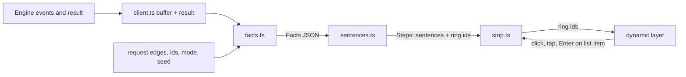

# Design Document

## Overview

The Tutor is a strip above the map in `web/`. Its first line is always the existing line (before a run the "Wifi hall, 70 access points. Results are a simulation." label, after a run the finished line), and its sentences come after it. It explains one finished run in fixed sentences filled with numbers from that run. It has no AI model. It reads the Engine result and the buffered progress events that the UI already keeps, plus four small additions to the Engine's events (Requirement 1).

Design decisions:
- **Three modules, one direction.** `facts.ts` (pure) turns the result, the events and the request edges into a `Facts` object with numbers and ids only. `sentences.ts` (pure) turns `Facts` into Steps of text. `strip.ts` (DOM only) shows a Step, handles back, next and "why this point", and tells the map which Points to ring. `facts.ts` imports nothing from `sentences.ts`, and `sentences.ts` imports no DOM. Nothing in `Facts` is text.
- **No arithmetic in `sentences.ts`.** Every number a sentence shows is a field of `Facts`, including derived ones such as "34 of 100 tries" (`hits` and `shots`). The number rule (Requirement 6.1) is then checkable by looking at the fields.
- **A sentence needs named facts.** Each sentence declares the `Facts` fields it needs. If one is missing, the sentence is not built (Requirement 4.14). A Step with no sentence left is not shown and not counted.
- **The Engine sends what the Tutor needs.** Rank was wrong for 3 of 15 picks when recomputed from the events (Requirement 1), so the Engine sends it.
- **Hybrid only.** The Steps explain the "atoms + rules (hybrid)" plan. For any other Selected_Plan the strip shows one sentence saying so (Requirement 3). The strip follows the Selected_Plan: the plan passed to it is the one chosen in the Plan_Selector, and choosing Hybrid again shows the Steps again.

Sources for the method are in the engine design (Schuetz et al., Phys. Rev. Research 8, 033296 (2026), doi:10.1103/nh3b-1wv5). The Tutor adds no new method and no new numbers.

## Architecture



New and changed files:

| Path | Purpose |
|---|---|
| `web/src/tutor/facts.ts` | `deriveFacts(input): Facts`, `whyFacts(facts, id): WhyFacts`. Pure. |
| `web/src/tutor/sentences.ts` | `buildSteps(facts, plan): Step[]`, `buildWhy(why): Step`, the sentence table. Pure. |
| `web/src/tutor/strip.ts` | `createStrip(deps): Strip`. The only DOM code. |
| `web/src/render/hit.ts` | `nearestPoint(xy, x, y, maxPx = 12): number` (-1 if none). Pure. |
| `web/src/render/dynamic-layer.ts` | New `setRing(indices)`. Drawn as a ring in the accent colour, no animation. |
| `web/src/screens/map.ts`, `run.ts`, `a11y.ts`, `style.css` | Place the strip, hand over the finished line, point selection, styles. |
| `scripts/record_tutor_runs.py` | Records the four Recorded_Runs. |
| `web/test-data/tutor/*.json` | The four recorded files: `hero_seed1`, `sparse_seed1`, `rules_only`, `place_rules_only` (committed). |

## Components and Interfaces

### Engine additions (Requirement 1)

All in `engine/src/atommap/`. `competitors.py` binds `type` and `competitor` to every event and needs no change, because `emit` forwards the new fields as they are.

- **`loop.py`, rule picks.** The replay that builds the rule `pick` events already tracks `replay`, the undecided set. `remaining = len(replay)` is read before the pick is removed. The event gets `remaining`, and `top_group`, `rank`, `frequency` set to `None`.
- **`loop.py`, loop pick.** `remaining` and `k` are already local variables (`StepInfo.remaining`, `StepInfo.top_group`). The event gets both. For `source == "atoms"` after the fallback check (`informed` true), `rank = ranked.index(pick) + 1` (1 is the top Point) and `frequency = freqs[pick]`, both computed from the same `ranked` and `freqs` the pick was drawn from. `ranked` holds all remaining Points, so the rank of an atoms pick in a step where other Points are alone in their group counts them (they have frequency 1.0, no frequencies event, and stand at the top of the ranking). A Point alone in its group that is itself picked gets source `"annealing"` (no atom ran for it), so its own `rank` and `frequency` are `None`. For source `"annealing"` or `"coin flip"` they are `None`. With the coin flip provider `top_group` is `remaining`, as in `StepInfo`. No random number is drawn for the new fields.
- **`loop.py`, `frequencies` event.** `shots` is the number of shots the Simulator returned. `_CountingSimulator.run_tile` in `simulator.py` stores `len(result)` in `FrequencyCache.last_shots` (a new attribute, set only on a real call). The event reads `cache.last_shots` and is emitted only when `cache.simulator_calls` grew, as now.
- **`atoms_alone.py`.** The `frequencies` event gets `shots: len(shots)`. Each `pick` event gets `remaining`, `top_group`, `rank` and `frequency` as `None` (Requirement 1.5).
- **Docs.** The engine design "Progress" bullet and engine Requirement 9.9 list the new fields.

Resulting event shapes (additions in bold):

| Event | Added fields |
|---|---|
| `pick`, source `atoms` (loop) | **`remaining`**, **`top_group`**, **`rank`**, **`frequency`** (numbers) |
| `pick`, source `annealing` or `coin flip` | **`remaining`**, **`top_group`** numbers, **`rank`**, **`frequency`** null |
| `pick`, source `rule` | **`remaining`** number, the other three null |
| `pick`, Atoms_Alone | all four null |
| `frequencies` | **`shots`** |

### Facts (`facts.ts`)

```ts
interface FactsInput {
  mode: "channel_plan" | "place";
  seed: number;
  ids: string[];
  edges: [string, string][];          // the request edges, for clash counts and cliques
  events: PlaybackEvent[];            // all buffered run events
  result: { competitors: Record<EngineName, CompetitorResult | { error: string }> };
}
interface Facts {                      // numbers, ids, booleans only. Any field may be absent.
  label?: string; mode; seed: number;   // label is left out when the result has no label, never defaulted; sentences that need it drop out (task 4)
  rulesFirst?: { count: number; first?: string; firstNeighboursLeft?: number; ring: string[] };
  groups?: { channel: number; pointsLeft: number; count: number; smallest: number; biggest: number;
             shots: number; ring: string[] };
  group?: { size: number; top: [string, string?]; neverLit: number; allClash: boolean; ring: string[] };
  atomPick?: { id: string; pointsLeft: number; topGroup: number; rank: number;
               hits: number; shots: number; ring: string[] };
  opened?: { count: number; ring: string[] };
  rounds: { channel: number; available: number; picks: number; byRule: number; byAtoms: number;
            byClassic: number; ring: string[] }[];
  result?: { total: number; quantumShare: number; quantumPicks: number; fiveGhzOnly: number;
             splits: number; skippedTiles: number; atomsNotNeeded: boolean };
  compare?: { name: EngineName; total: number; tie: boolean }[];
  points?: Record<string, { clashes: number; rounds: { channel?: number; outcome: "rule" | "atoms" | "classic" | "neighbour" | "fiveGhz"; by?: string }[] }>;
                                       // per Point record read by whyFacts; absent when the Hybrid has no events
}
```

Derivations, all from Hybrid events in arrival order:
- `rulesFirst.count`: `pick` events with source `rule` before the first `simulate` event, in any channel. `firstNeighboursLeft` is the length of `removed` of the first one (0 or 1 gives the "no other pick is lost" wording, 2 or more the "all clash with each other" wording). Its `ring` is the Point and its `removed` Points.
- **Step 2 opening.** When 
ulesFirst.count is 0 (the rules made no pick before the atoms ran), Step 2 starts with "All N points were too tangled for the rules." in place of "The other N points ...", because no point had been picked yet. N is groups.pointsLeft in both. When the 
ulesFirst fact is absent the old wording is used.
- `groups`: the first `simulate` event's `(round, step)`. All `simulate` events with that pair are its groups. `pointsLeft` is `remaining` of the `pick` event of that step, `shots` is from the matching `frequencies` events. `ring` is the union of the group ids.
- `group`: the biggest group of those, first in event order on a tie. `top` is its two highest `frequencies`, ties by id. `neverLit` counts frequency 0. `allClash` is true when every pair of its Points is in `edges`. `ring` is the group.
- `atomPick`: the first `pick` event with a non-null `frequency`. `shots` comes from the LATEST `frequencies` event of that Round that contains the picked id, at or before the pick in event order (the frequency can come from the cache, so that event may be from an earlier step); if none exists, `atomPick` is absent. `hits = round(frequency * shots)`, `pointsLeft = remaining`, `topGroup = top_group`.
- `opened`: the run of `rule` picks that directly follow that pick in the same Round. Skipped (field absent) when the atoms ran but there is no `atomPick` (Requirements 4.8, 4.12).
- `rounds[i]`: `available` is the number of distinct ids in the Round's `picked` and `removed` lists (valid because of Property 4). `byRule`, `byAtoms` (non-null `frequency`), `byClassic` (the rest) count the Round's picks. `ring` is the Round's picks. In Place there is one entry and no channel numbers are shown.
- `result` and `compare` come from `stats` and the four `total_picks`. `quantumShare` uses the Scoreboard's number and its formatting function (`scoreboard-model.ts`).
- Fields whose source is missing (no events, an `{error}` entry, no `simulate` event, `atoms_not_needed`) are left out and never defaulted.

`Facts.points` is filled by `deriveFacts` for every Point (ids and numbers only) and `whyFacts` is a pure lookup into it. `whyFacts(facts, id)` returns `{ id, clashes?: number, rounds: { channel?, outcome: "rule" | "atoms" | "classic" | "neighbour" | "fiveGhz", by?: string }[], ring: string[] }`. `clashes` is the degree in `edges`. `neighbour` carries the id of the picked neighbour (the `pick` event whose `removed` contains the Point). `fiveGhz` is the last entry of a Channel_Plan Point in `five_ghz_only`. A picked Point gets no entry for later Rounds. `clashes` is left out when the run holds no record of the Point. `WhyFacts` also carries `mode` (filled by `whyFacts` from `Facts.mode`). `buildWhy(why)` chooses channel or Place wording from `mode`, never from whether a round entry has `channel`, so a lost `channel` in Channel_Plan drops its sentence and does not switch wording (same rule as the Step 2 and Step 6 defs). The 5 GHz sentence is Channel_Plan only. `buildWhy` exposes its table as `whyDefs(why)`; the "no record" def declares `absent: ["clashes"]` (it is built when `clashes` is missing and `rounds` is empty), so Property 3 checks it on the reduced facts, and every other def against the full build. `buildWhy` says "This run holds no record of this point." when both `clashes` and `rounds` are empty.

### Rings (Requirement 2.10)

Each Step and the Why_Answer carry `ring: string[]`, taken from the facts above.

| Step | Ring |
|---|---|
| 1 rules first | the first safe pick and its neighbours |
| 2 groups | all Points of the groups of that loop step |
| 3 one group | the biggest group |
| 4 one pick | the picked Point |
| 5 after it | the picks it opened |
| 6 per Round | the picks of that channel |
| 7, 8 | none |
| Why this point | the Point and the neighbour that was picked (each picked neighbour, one per Round) |

The strip calls `deps.onRing(ids)`. `map.ts` maps ids to indices and calls `dynamicLayer.setRing(indices)` and redraws once. Leaving the Tutor clears the ring.

### Sentences (`sentences.ts`)

```ts
interface SentenceDef { step: 1|2|3|4|5|6|7|8; needs: string[]; make(f: Facts, i?: number): string }
interface Step { key: string; sentences: string[]; ring: string[] }
```
`buildSteps` evaluates the table in order. A def runs only when every path in `needs` is defined in `Facts`. Steps with no sentence are removed, then `strip.ts` numbers the rest 1 to M. Step 6 is one Step per entry in `rounds`. Step 7 and Step 8 text (when `atomsNotNeeded` Step 7 says "No group went to the atoms, so nothing was split or skipped." in place of the splits and skipped sentence, which still shows 0 for runs where atoms were used), "One run proves nothing.", the label "simulation" and "tie" are fixed wording. Step 4 says "doesn't just take the top point" and never "the atoms chose" or "decided" (Requirement 4.6). Step 8 lists totals as plain numbers, no winner. `buildWhy` uses the same table mechanism with `needs` on `WhyFacts`.

Length budget: the strip has 3 lines and the first line (the finished line) takes one, so a Step or a Why_Answer gets 2 lines. Each is at most 260 characters. Measured at 0.9rem: about 6.4 px per character and about 900 px of text width, so about 140 characters per line and 280 for 2 lines. A test checks this on the Recorded_Runs and on the worst case numbers of the generator. Text is never clipped: if a Step ever exceeds the box it scrolls inside it (`overflow-y: auto`), so nothing is hidden.

### Strip (`strip.ts`)

```ts
interface StripDeps { onRing(ids: string[]): void; announce?: never }
interface Strip {
  el: HTMLElement;
  showIdle(label: string, text: string[]): void;        // before a run (2.2): label first, then the sentences
  showFinished(firstLine: string, facts: Facts, plan: EngineName, focus: boolean): void;
  showWhy(id: string): void;                            // click, tap or Enter on a list item
  leaveWhy(): void;                                     // Escape, click on empty map, "back to step N"
  hide(): void;                                         // during a run (2.4)
}
```
- **Markup.** `<section aria-label="Tutor">` with a two-column grid: left the text (first line, then the Step sentences), right the buttons "Back", "Next" and the text "step N of M" in one row (Requirement 2.6). A visually hidden `<div aria-live="polite" aria-atomic="true">` holds the same text.
- **Screen readers.** On Back and Next the live region is set to the new Step text and focus stays on the button (Requirement 2.11). The visible text is not a live region, so nothing is read twice. The first line is the existing finished line: `run.ts` no longer shows it. It calls `showFinished(text, ..., hadFocus)` and the strip gives its first line `tabindex="-1"` and focuses it when the old bar held focus (the focus rule of the ui spec, `focusInside` in `focus.ts`).
- **Selecting a Point.** A pointer click or tap on the dynamic canvas calls `nearestPoint(xy, x, y, 12)` with the screen coordinates the layer already holds. A hit calls `showWhy(id)`. A miss while a Why_Answer is shown calls `leaveWhy()`. The keyboard list (`a11y.ts`) gets an `onActivate(id)` callback, fired by Enter or Space on the focused item. That is the same call as a click on that Point. Arrow keys still only move focus. Leaving a Why_Answer restores the Step that was shown before and its ring (Requirement 5.6). While a Why_Answer is shown, the Back and Next buttons are replaced by one button "back to step N" (N is the Step that was shown before), and the counter reads "about ap12" in place of "step N of M". The button calls `leaveWhy()`.
- **Only Hybrid.** When the Selected_Plan is not Hybrid, the strip shows the first line and one sentence ("This explanation covers the atoms + rules (hybrid) plan only.") with no Steps, no ring and no Why_Answer.
- **Before a run.** `showIdle` shows the existing "Wifi hall, 70 access points. Results are a simulation." label as the first line, then one or two sentences about the Points and lines. It does not repeat the tagline. The label text is unchanged (Requirement 2.3). For the Your_Map of the ui spec (Requirement 8) the first sentence is neutral: `buildIdle(mode, kind)` with `kind` `"your_map"` gives "Each dot is a point. A line joins two that are closer than r, so they can't both be picked." in place of the cafe sentence. The other two idle texts and every Step and Why_Answer are unchanged.
- **Text is set with `textContent`.** Never `innerHTML`.

### Layout and Fits_Screen

Target: a 1366 x 768 viewport, inner size (`innerWidth` x `innerHeight`), not the whole screen.

Current layout (`map.ts`, `run.ts`, `style.css`): the title, the tagline, the toolbar, the label line, the run bar, then `.map-row` with the map column (map plus `.map-under`) and the Scoreboard column (27 rem). After a run the toolbar and tagline are hidden. `layout()` in `map.ts` sizes the map as `innerHeight - wrap.top - 40 - under.offsetHeight`, clamped to 240..640 px, and it reads `wrap.getBoundingClientRect().top`. It only runs again when the width changes. It SHALL also run again when the height changes (the resize handler compares both `innerWidth` and `innerHeight` with the last values).

Fitting the strip:
- The strip sits where the label line and the finished status were, in the flow between the toolbar and `.map-row`. Its first line is always the existing line (the label before a run, the finished line after a run), and the sentences come after it. `run.el` is hidden after the run. The strip is full width and above both columns.
- Fixed height: `height: calc(3 * 1.4 * 0.9rem + 1rem)`, about 77 px with padding and border, for every Step, the idle text and the Why_Answer, so the map never moves (Requirement 2.7). The text column has a fixed width (grid `1fr auto`), buttons on the right in the same row.
- Budget at 1366 x 768. A 77 px strip was tried in the browser and the Scoreboard ends at 749 px of 768, so the fit is tight (19 px spare). The gaps between the 4 Scoreboard cards shrink a little to keep it. The Tutor text and its height do not shrink. The map is sized by `layout()` from `wrap.top`, so it shrinks by what the strip adds.
- `map.ts` calls `layout()` after `strip.showFinished`, `strip.hide` and `showIdle`, like it does after `onFinished` today, and on every width or height change.
- The Scoreboard column is taller than the map in some states. Its height is the limit, so the 1366 x 768 smoke test checks the whole page (`document.scrollingElement.scrollHeight <= innerHeight`), not only the map.
- Smaller viewports (about 650 px inner height): the page MAY scroll. The strip, the map and the 4 cards SHALL stay visible, and the legend MAY be below them.
- Narrow screens (max 40 rem): the grid becomes one column, the height becomes `min-height` and the buttons go under the text (Requirement 2.8). Colours, focus ring and 400 and 500 weights follow `.kiro/steering/design.md`. The Why_Answer uses the same box.

### Recorded_Runs

`scripts/record_tutor_runs.py` runs the native Engine (`atommap.api.run`) with the real Braket simulator and collects every event into `web/test-data/tutor/<name>.json` as `{request, events, result}`. Settings are fixed in the script before any run (honesty rule 8):

| File | Map | Seed |
|---|---|---|
| `hero_seed1.json` | `fixtures/wifi_hall_hero.json`, Channel_Plan, walls off | 1 |
| `sparse_seed1.json` | `fixtures/wifi_hall_sparse.json`, Channel_Plan | 1 |
| `rules_only.json` | a small hand-made tree map (6 Points) that the simplicial rule solves alone, Channel_Plan | 1 |
| `place_rules_only.json` | a small hand-made tree map (6 Points) that the rules solve alone, Place, straight line | 1 |

The script is run by hand with `OPENBLAS_NUM_THREADS=1`. The web tests read these files and never call the Engine. Until a file exists, its tests are skipped with a message naming the file, not replaced by invented data.

## Data Models

`Facts`, `WhyFacts`, `Step` and the event shapes are given above. Event fields follow the engine events used by the ui spec. Facts are plain JSON (`JSON.stringify` round trips), which is what lets a later service take them unchanged. A Recorded_Run file is `{ request: {points, mode, graph, seed}, events: Event[], result }`.

## Correctness Properties

*A property is a characteristic or behavior that should hold true across all valid executions of a system-essentially, a formal statement about what the system should do. Properties serve as the bridge between human-readable specifications and machine-verifiable correctness guarantees.*

Properties 1 to 3 hold for the pure sentence functions and use generated `Facts` (any field may be absent, numbers are arbitrary non-negative integers or fractions the Scoreboard formats, ids look like `ap12` or `cafe003`). Properties 4 and 5 hold for the Engine and use generated requests with a fake Simulator. Strip placement, rings, focus, layout and Fits_Screen are UI and get example and smoke tests.

### Property 1: Every number in a sentence is a fact of the run

*For any* `Facts` and any `WhyFacts`, every number written in any sentence of any Step and any Why_Answer (point ids removed from the text first, the fixed "5 GHz" removed) is the formatted value of a numeric field of that `Facts` or `WhyFacts`.

**Validates: Requirements 6.1, 6.5**

### Property 2: Banned words never appear

*For any* `Facts` and any `WhyFacts`, no sentence of any Step or Why_Answer contains "faster", "speed", "wins", "winner", "beats", "best", "the atoms chose" or "the atoms decided" (compared in lower case).

**Validates: Requirements 4.6, 6.3, 6.7**

### Property 3: A missing fact drops its sentence and nothing else

*For any* `Facts` and any single field removed from it, the sentences built from the reduced `Facts` equal the sentences built from the full `Facts` minus exactly those sentences that list that field in `needs`, no text contains "undefined", "NaN" or "null", and the shown Steps are numbered 1 to M with M the number of Steps that still have a sentence.

**Validates: Requirements 2.6, 4.14, 6.8**

### Property 4: Every available Point ends its Round picked or removed

*For any* valid request and any Competitor except Atoms_Alone, for each Round the Points available in it are exactly the disjoint union of the `picked` ids and the `removed` ids of that Round's `pick` events, and no id is in both. The same check runs on each of the four Recorded_Runs.

**Validates: Requirements 5.3, 5.5**

### Property 5: Progress events do not change picks, log or Stats, and carry well-formed fields

*For any* valid request and Seed, the serialized result with `emit=None` equals the serialized result with an `emit` that collects events, and in the collected events every `pick` has `remaining`, `top_group`, `rank` and `frequency` set as Requirement 1.2 to 1.5 says for its source (for source `atoms` from the loop: `1 <= rank <= remaining`, `top_group` equals the `StepInfo.top_group` of that step, and `0 <= frequency <= 1`), and every `frequencies` event has `shots` equal to the number of shots the fake Simulator returned.

**Validates: Requirements 1.1, 1.2, 1.3, 1.4, 1.5, 1.6, 1.7**

## Error Handling

| Case | Behaviour |
|---|---|
| A needed Fact is missing | That sentence is left out. A Step with no sentence is not shown (4.14) |
| No events (empty buffer) or the Hybrid entry is `{error}` | `deriveFacts` returns only `label` (when present), `mode`, `seed`. The strip shows the first line only, no Steps |
| Event without the new fields (older recorded run) | `rank`, `frequency` and `shots` are absent, so Steps 3 to 5 lose the sentences that need them |
| Click on no Point within 12 px | Nothing, or the Why_Answer is left if one is shown |
| Selected_Plan not Hybrid | One sentence, no Steps, no Why_Answer (3.2) |
| Step text longer than the box | The text area scrolls. Text is never cut |
| Recorded_Run file missing | Its tests are skipped with the file name in the message |

## Testing Strategy

Property-based testing applies to the sentence functions (pure, large input space) and to the Engine event fields. It does not apply to strip placement, focus, rings drawing and layout, which use example, jsdom and smoke tests.

**Property tests** (at least 100 iterations each, one test per property, comment `Feature: tutor, Property N: <title>`):
- Properties 1 to 3: `vitest` with `fast-check` in `web/`. The `Facts` generator makes every field optional so absent facts are covered. Ids use the prefixes `ap` and `cafe`, so an id can never contain a banned word.
- Property 4: `hypothesis` in `engine/tests/` with the fake Simulator and `OPENBLAS_NUM_THREADS=1`, plus a `vitest` check over the four Recorded_Runs.
- Property 5: `hypothesis` in `engine/tests/`, with a fake Simulator that returns a random number of shots.

**Unit and example tests:**
- Recorded_Runs: the Steps of each file match a snapshot. The Hero run has Steps 1 to 8. `rules_only` has no Steps 2 to 5 and says the atoms weren't needed. `place_rules_only` does the same in Place: one Round, no channels, and the Why_Answer wording "picked by a rule" or "not picked, its neighbour <id> was picked". The sparse run shows its Quantum_Share, even 0%. Each Step and Why_Answer is at most 260 characters. Ring ids per Step match the table above and exist in the request.
- Step 1 wording for a pick with 0, 1 and 2 or more neighbours left. Step 3 for an all clash group. Step 4 with and without an `atomPick`. Place mode has one Round and no channels. Step 8 shows "tie" for equal totals.
- `nearestPoint`: a hit at 12 px, a miss at 13 px, the nearest of two, an empty list.
- Strip (jsdom): Back and Next change the text and the counter, the live region equals the Step text, focus stays on the button, the finished line takes focus when the old bar held it, a Why_Answer shows one button "back to step N" instead of Back and Next, that button and Escape leave the Why_Answer and restore the Step, a non-Hybrid plan shows the one sentence.
- `layout()`: a height-only resize changes the map size.
- Engine: the `frequencies` event `shots` and the rank of an atoms pick in a step where other Points are alone in their group (they have frequency 1.0, no frequencies event, and the rank counts them; the case that was wrong).
- Modules: `facts.ts` imports nothing from `sentences.ts`, `sentences.ts` imports no DOM (a grep style check in a test).

**Smoke (Playwright):** at 1366 x 768 the finished screen has `scrollHeight <= innerHeight`, the strip box has the same height on every Step and on a Why_Answer, and at a phone width the strip may grow. The run page makes no request outside the same origin.
