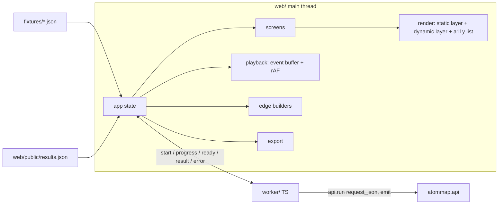

# Design Document

## Overview

The UI is a static Vite and TypeScript app in `web/`. It talks to the existing Worker (`worker/`), which runs the Engine (`atommap.api.run`) in Pyodide. The UI draws the map, plays back progress events, shows the Scoreboard and exports the plan. It holds no MIS algorithm. The only computation it owns is small map helpers: building conflict edges (walls model, straight line) for display and for the request.

Design decisions:
- **Canvas, in layers, not SVG.** The place maps have hundreds of Points plus thousands of street segments and edges. A static canvas layer is drawn once. A small dynamic canvas layer redraws only what animates. SVG would keep thousands of DOM nodes and restyle them during animation. Canvas needs an explicit accessibility layer (see Accessibility).
- **Events are buffered, then replayed.** The Worker's progress messages only append to an array. A `requestAnimationFrame` loop reads the array and applies the events due that frame.
- **Committed fixtures only.** Hero map, walls and the place map (Kadıköy, Istanbul) are static files. Nothing is fetched at runtime except these files and the Worker assets from the same origin.
- **Animation shows Hybrid only; the finished map shows the selected plan.** During a run only `Hybrid` events are drawn. After the result arrives, the Plan_Selector chooses which of the four Competitors' plans the map and the export read from the result (default Hybrid). The Plan_Selector is the Scoreboard cards themselves, not a separate row of buttons: the page is exactly 768 px tall at 1366x768 and a new row would scroll. The Plan_Selector is the Scoreboard cards themselves, not a separate row of buttons: the page is exactly 768 px tall at 1366x768 and a new row would scroll.

## Architecture



Layout of `web/src/` (new files):

| Path | Purpose |
|---|---|
| `main.ts`, `state.ts` | Boot, screen switching (including the `#/results` hash route), one state object (map, mode, toggle, seed, run status, result) |
| `client.ts` | Wraps `new Worker`, typed with `worker/src/messages.ts` |
| `screens/loading.ts`, `map.ts`, `run.ts`, `scoreboard.ts`, 	utor.ts, 
esults.ts | One module per screen or panel (`results.ts` is the Results_Page) |
| `data/results.ts` | `loadResults()` and `validateResults()` for `results.json` (pure validator) |
| `render/static-layer.ts`, `dynamic-layer.ts`, `sprites.ts`, `a11y.ts` | Canvas drawing, glow sprites, accessible point list |
| `render/playback.ts` | Event buffer, rAF loop, pure reducer from events to point states |
| `edges/walls.ts`, `edges/straight.ts` | Edge builders owned by the UI |
| `data/fixtures.ts`, `data/custom-map.ts` | Fixture loading (including the per-place loader) and the Map_Text parser (CSV and GeoJSON) |
| `your-map/editor.ts` | Pure Map_Editor logic: add, remove, Clear, random (no DOM) |
| `scoreboard-model.ts`, `seed.ts`, `export.ts`, `settings.ts` | Pure functions: Scoreboard numbers, seed parsing, CSV/GeoJSON, default seed |

Build: Vite with relative `base: './'` for GitHub Pages. Fixtures are imported with `?url` from `../../fixtures/` (Vite `server.fs.allow` for the repo root) and copied to the build output.

## Components and Interfaces

### Worker message protocol (existing, `worker/src/messages.ts`)

| Direction | Message | Payload |
|---|---|---|
| UI to Worker | `start` | `{points:[{id,x,y}], mode, graph:{r, edges?}, seed}` |
| Worker to UI | `progress` (loading) | `{stage, percent, detail?}`, stage is `pyodide`, `engine`, `packages`, `boot` or `warmup` |
| Worker to UI | `ready` | `{elapsedMs, lean}` |
| Worker to UI | `progress` (run) | the Engine event dict, see below |
| Worker to UI | `result` | the parsed `result` object: `{meta, competitors}` |
| Worker to UI | `error` | `{type, message, dependency?, kind?, items?}` |

`mode` is `"channel_plan"` or `"place"`. The UI does not send `competitors`, so all four run. The UI maps `stage` to a plain sentence (Req. 1.2), and `ready` replaces the Loading_Screen (Req. 1.3). An `error` before `ready` is shown on the Loading_Screen (Req. 1.4). An `error` during a run shows the message on the Run_Screen with a back button.

### Engine events used by the UI

Existing (from `atommap.api`): `{type:"run", kind:"simulate", competitor, round, step, tile:[ids]}` and `{type:"run", kind:"pick", competitor, round, step, tile:null, picked:[id], source:"atoms"|"annealing"|"coin flip"|"rule"}`. `competitor` is one of `Atoms_Alone`, `Hybrid`, `Annealing_Rules`, `Coin_Flip_Rules`. `round` is the channel (1, 6, 11) in Channel_Plan and 1 in Place.

Added by the Engine prerequisite below: `kind:"frequencies"` with `{competitor, round, step, tile:[ids], frequencies:{id: number 0..1}}`, and `removed:[ids]` on every `pick`.

### Rendering (smooth on about 300 and 70 Points)

Three stacked elements in one container, all sized by CSS and scaled by `devicePixelRatio`:

1. **Static canvas.** Streets (Place), Walls (Channel_Plan) and conflict edges, drawn in one pass into a single batched path per style (one `stroke()` per style, not per segment). Redrawn only when the map, the distance toggle, the container size or the pixel ratio changes. Never redrawn per frame.
2. **Dynamic canvas.** Points, glow, lock-in pulse, fading neighbours, tile outlines and the focus ring. A point is drawn from a small per-point state held in typed arrays (`glow`, `lockT`, `fadeT`, `status`). Glow uses pre-rendered sprites (one offscreen canvas per glow level, 8 levels) drawn with `drawImage`. `shadowBlur` and per-frame gradients are not used. Channel shapes (circle, triangle, square, hollow circle) are cached `Path2D` objects.
3. **Accessibility layer.** See Accessibility.

Playback (`render/playback.ts`):
- `client.ts` pushes each `progress` run event onto `buffer[]` and returns. It does no drawing and does not touch state.
- The rAF loop starts when a run starts and stops when the buffer is drained, no tween is active and the result has arrived. At most one dynamic redraw happens per frame. The loop does not run while idle.
- Each frame, a pure reducer `apply(state, event)` consumes the events due this frame. Due count is set by the speed control (events per second, default and steps in `settings.ts`). Several events in one frame are applied in order and drawn once (coalescing).
- Only `competitor === "Hybrid"` events change the map. Events of the other three only update a plain-words status line ("Annealing + rules is running").
- `frequencies` sets the glow target of the Tile's Points (glow level = frequency). `pick` locks the Point (small pulse) and fades `removed`. A pick with source `rule` is drawn as an outlined lock with a "rule" tag. A pick with source `annealing` (a single-Point Tile, not atom-informed) is a plain lock with no glow. `simulate` draws the dashed stitch outline of its Tile until the next `frequencies` event.
- Skip sets the cursor to the end of the buffer, waits for `result`, and applies the final state without tweens. The end state equals the state after full playback (checked by a test).
- `prefers-reduced-motion: reduce`: no rAF tweening, no glow transitions, no fades. The Run_Screen shows static steps: one state per Round with a "next round" button and the same skip button. Colours and shapes change at once.
- After the result arrives, the Round colours come from the selected Competitor's `rounds` and `five_ghz_only` in the result, not from the event stream. Atoms alone also shows the Points it left uncovered (`stats.gaps`).

### Plan_Selector

`state.selectedPlan` is one of the four engine names, `Hybrid` at the start of each run. The Plan_Selector is the four Scoreboard cards. There is no separate row of buttons.

- **Markup.** The card container is `role="radiogroup"` with the label "plan on the map". Each card title is one `role="radio"` with `aria-checked` and a roving `tabindex` (0 on the selected radio, -1 on the others; if the selected one is disabled, 0 on the first enabled one). The Details toggle stays its own control inside the card.
- **Keys.** The usual radio pattern: Left or Up moves to the previous enabled radio, Right or Down to the next, both wrapping. Moving also selects, as native radios and the ARIA radio pattern do. Space and Enter select the focused radio. A click selects.
- **When it works.** Only after `result` arrives. While the run is on, cards are pending and their radios are disabled (`aria-disabled`, not in the tab order). A Competitor entry `{error}` has its radio disabled and the reason stays as text in the card.
- **Look.** The selected card gets an accent border and a short text tag "on the map" inside the card, so the choice is not colour alone. The tag sits on the line of the total and the picks per round, where the card has free room, so the card height does not change. The border keeps its width. Nothing marks a card as the winner: Hybrid is only the default, and no banned word is used (faster, speed, wins, winner, beats). No selected plan name is shown above the map; the tag does that job.
- **Effect.** Selecting redraws the dynamic layer from `result.competitors[selectedPlan]` (`rounds`, `five_ghz_only`, and the `source` of each pick in `decision_log` for filled or outlined shapes) without a new run and without animation. Atoms alone also marks the points it left uncovered (`stats.gaps`) with a dashed ring and a legend entry, shown while that plan is selected. Going back to Hybrid redraws the final state of the run.
- **Tutor.** The strip gets the selected plan through `strip.setPlan(plan)`. For a plan that is not Hybrid it shows the first line and the one sentence of tutor Requirement 3.2, with no Steps, no ring and no Why_Answer (clicks on points do nothing, and an open answer is left). Back on Hybrid it shows the Steps again from Step 1 with its ring.

Export reads the same selection.

All Engine work stays in the Worker (Req. 11.1). The main thread only appends events, runs the rAF loop and draws. Targets that follow from requirements: the Engine load and run times are those of the engine spec (Req. 11.8, not redefined here); the static layers are drawn once per change; the dynamic layer is drawn at most once per frame. No frame-rate figure is promised and nothing user-facing claims speed (honesty rule 1).

### Accessibility

- A visually hidden `<ul>` mirrors the Points, in id order, each item with text such as "ap12, picked on channel 6" and a state that updates after the run. It uses one roving `tabindex`: Tab enters the list once, arrow keys move to the nearest Point in that direction on screen, and the focused Point gets a focus ring on the dynamic canvas. Screen readers get the list, not hundreds of tab stops.
- One `aria-live="polite"` region announces Round and run state changes ("Round 2 of 3 done, 21 picks"), never per event.
- Every button, toggle and input has a visible label and focus ring (accent `#7f77dd`). The map container has an `aria-label` that states the map name, Point count and mode.
- Channel and state shapes come from `.kiro/steering/design.md` (1 circle, 6 triangle, 11 square, 5 GHz only hollow circle) and are drawn with colour and shape. Text and background colours follow the steering palette (AA).
- One column below a CSS width breakpoint.

### Edge builders

`edges/walls.ts` (Channel_Plan, Hero_Map):

```ts
interface Wall { x1:number; y1:number; x2:number; y2:number; kind:"concrete"|"drywall" }
function buildWallEdges(points: Pt[], walls: Wall[], wallsOn: boolean, r: number): [string,string][]
```
An edge exists when power is strictly greater than the Signal_Threshold. The function computes it as `receivedPowerDbm(r)`, with `r` read from the Hero_Map fixture (about -69.03 dBm for r = 20 m). It is not a constant in `settings.ts`. With walls off this equals the straight-line r < 20 m graph.
For each pair with distance d, received power = `10 - 40 - 30*log10(d) - sum(loss of crossed walls)`, where concrete is 12 dB and drywall is 4 dB (both only when `wallsOn`). A wall is crossed when the straight segment between the two APs properly intersects the wall segment. Pairs are returned once, sorted by id. Constants live in `settings.ts` with the Radio_Model comment. The request carries `graph: {r: 20, edges}` where `r` is read from the fixture.

`edges/straight.ts` (Place, straight line): all pairs with distance below `r`, the same rule the Engine uses when edges are omitted. The UI needs these only to draw them. The request sends `graph:{r:150}` without `edges`.

### Place: walking edges

Walking edges come from the Street_Fixture of the selected place (see Place data). The request sends `graph:{r:150, edges: fixture.walking_edges}`.

### Scoreboard model

`scoreboard-model.ts` turns `result.competitors` into four cards, keyed by engine names and labelled "atoms alone", "atoms + rules (hybrid)", "annealing + rules", "coin flip + rules". Per card, from `CompetitorResult`:
- picks per Round: `rounds[i].picks.length` (channel `rounds[i].channel`); total: `stats.total_picks`.
- Quantum_Share: `stats.quantum_picks` of `stats.total_picks` and `stats.quantum_share` as a percent, always shown, including 0%.
- `stats.atoms_not_needed` true shows "atoms weren't needed on this map".
- `stats.splits`, `stats.skipped_tiles`, `stats.mismatches` always shown, including 0. `stats.gaps` count is shown for atoms alone.
- label from `label` ("simulation").
- A competitor entry `{error}` shows the error text in plain words, no numbers.
- Ties: competitors with equal `total_picks` get the word "tie". No card is styled as winner. Cards use one shared component.
- The seed, the note "One run proves nothing." and the citation text are on the Scoreboard.

### Seed

`seed.ts` parses the typed text: trimmed, matches `^-?\d+$` and is a safe integer. Otherwise the UI shows a plain message and does not call the Worker. "Run again with another seed" uses previous seed + 1. The default seed is a constant in `settings.ts`, decided before running (honesty rule 8).

### Export

`export.ts`, for the plan selected in the Plan_Selector. CSV header: `id,x,y,round,result_label,seed`; `round` is the channel, `5 GHz only` in Channel_Plan for unpicked Points, and `1` or `not picked` in Place. Fields with commas, quotes or newlines are quoted. GeoJSON: a FeatureCollection with top-level `result_label` and `seed`, one Point feature per Point with `id`, `x`, `y`, `round`, `result_label`, `seed` properties. Geometry is `[lon, lat]` for the place map (Kadıköy) and `[x, y]` in local metres for other maps (stated in a top-level `units` member). Files are made with `Blob` and an `<a download>`. The file name is `atommap-<map>-<plan>-seed<seed>.csv` or `.geojson`: `<map>` is the map name (`hero`, `kadikoy`) and `<plan>` is the card label, both lower case with letters and digits only and one `-` between words (for example `atommap-hero-atoms-rules-hybrid-seed1.csv`); a negative seed is written with `m` for the minus sign (`seedm5`). Pure functions build the CSV text, the GeoJSON object and the file name; only the download helper touches the DOM. The geometry is `[lon, lat]` when every point of the map carries `lon` and `lat` (the `PlaceFixture` points do), and `[x, y]` otherwise; `units` says which.

### Your map

The third choice of the Mode group ("Your map (1 round)", value `your_map`). It is Place mode rules with straight-line distance: one Round, the visitor's own Points, the visitor's r. The Engine is not changed.

**Request.** `MapChoice` gets a third variant and `buildRequest` stays the one place that builds every request:

```ts
| { mode: 'your_map'; points: readonly RequestPoint[]; r: number }
// buildRequest -> { points, mode: 'place', seed, graph: { r, edges: buildStraightEdges(points, r) } }
```

The request carries the edge list explicitly, not r alone. The drawn edges and the sent edges are then the same list (one call of `buildStraightEdges`, pairs strictly closer than r, each once, sorted), and a test can check it. It gives the same graph as r alone, because the Engine uses the same rule when edges are omitted (`graph.py`). Everything else in the Engine works as for any other map: tiles of at most 10 atoms, the layout split, the four Competitors. The tutor, the Plan_Selector and the export read the same result shape.

**Area and view.** The Your_Map_Area is 90 m by 60 m (`YOUR_MAP_AREA_M` in `settings.ts`), about the 84 m by 58 m of the Hero_Map. It is drawn as a thin dim frame in the static layer. `StaticScene` gets an optional `bounds` (min and max x and y). `fitView` uses `bounds` when it is given, instead of the extent of the Points, so an empty map still has a view. For the Your_Map the bounds are the area joined with the bounding box of the Points, so a pasted map larger than the area is fully visible and clicking still works. `render/static-layer.ts` also gets `toWorldX` and `toWorldY` (the inverse of `toScreenX` and `toScreenY`) to turn a click into metres. These are drawing helpers, not algorithm. `layout()` in `map.ts` takes its spans from `bounds` and must not call `Math.max` on an empty list.

**Editor logic (pure, `your-map/editor.ts`).** No DOM, no randomness of its own.

```ts
interface YourPoint { id: string; x: number; y: number; lon?: number; lat?: number }
interface EditorState { points: YourPoint[]; nextId: number }
type EditResult = { state: EditorState; message: string | null };

emptyMap(): EditorState                                   // points [], nextId 1
addPoint(s, x, y, limit): EditResult                      // rounds to 0.1 m, rejects outside the area or at the limit
removePoint(s, id): EditorState                           // only that id
clearMap(s): EditorState                                  // also resets nextId to 1
addRandom(s, n, rng: () => number, limit): EditResult     // adds min(n, limit - count) points, message when it added fewer
replaceMap(points): EditorState                           // after a good Map_Text; nextId = 1 + largest p<number> id
clickAt(s, x, y, hitId: string | null, limit): EditResult // hitId set: remove it; otherwise add at x, y
```

Ids are `p` plus the number zero padded to 3 digits (`p001`, then `p1000` after `p999`). `nextId` only grows between Clears, so an id is never reused for another Point inside one map, and `replaceMap` keeps generated ids clear of imported ones. The hit test is the existing `nearestPoint` in screen pixels (12 px), so the editor itself only sees an id or null. "Add random points" adds 10 (`RANDOM_BATCH`). The UI passes a `mulberry32` generator seeded with `RANDOM_SEED_BASE + presses` (constants in `settings.ts`), so the same presses give the same Points and tests can pin them.

**r input.** A labelled `<input type="number" min="2" max="200" step="any">` with the default 20 (`YOUR_R_DEFAULT`, `YOUR_R_MIN`, `YOUR_R_MAX`). `parseR(text)` returns the number or the plain message "r must be a number from 2 to 200 metres." While the typed text is valid, the edges are redrawn with it. While it is not, the picture keeps the last valid r, the message shows and the run button refuses.

**Map_Text panel.** While a Your_Map is chosen and no run has started, the column on the right of the map (where the Scoreboard opens during a run) holds a "Points as text" panel: a `<textarea>` labelled "Paste points as CSV: id,x,y in metres", a file input labelled "or choose a CSV or GeoJSON file", a "Use these points" button and a status line (`role="status"`, errors `role="alert"`). It is hidden when a run starts. Beside the map it adds no height to the page, because the map column is at least as tall as the panel (the panel has a fixed 6 row text box, the map is at least 240 px). At 60 rem or narrower it sits under the map in the single column. Choosing a file reads it into the text box and applies it. Applying is one button, so the whole path works with the keyboard and a screen reader (Requirement 8.20). Size check first: a file over 1 MB is refused before it is read. The kind is chosen by the file name (`.geojson`, `.json` or `.csv`), and for pasted text by the first character (`{` means GeoJSON, anything else CSV).

**Parser (`data/custom-map.ts`).** `parseMapText(text, kind, limit)` returns `{ok:true, points}` or `{ok:false, reason}` and never throws.

- CSV: a byte order mark and blank lines are ignored. The delimiter is the one of comma, semicolon and tab that appears most in the first line. Fields may be quoted in the usual way (a quoted field can hold the delimiter and doubled quotes), so a CSV exported by AtomMap (`id,x,y,round,result_label,seed`) can be read back. Columns are found by name (`id`, `x`, `y`, any case, any order, others ignored). `x` and `y` must be finite numbers with a dot and not beyond 1,000,000 m. Ids are trimmed, non-empty and unique.
- GeoJSON: a FeatureCollection, a Feature or a bare Point geometry. Every feature must be a Point with finite `[lon, lat]`, longitude within ±180 and latitude within ±90. The origin is the mean latitude and longitude of the points (rounded to 6 decimals, as `centroid` in `fetch_place.py`), and `x = radians(lon - lon0) * cos(radians(lat0)) * R`, `y = radians(lat - lat0) * R` with R = 6371008.8 m, rounded to 0.1 m (the constants and rounding of `project` in `fetch_place.py`). The id is `properties.id` when it is a non-empty text or number, otherwise the next free `p001`-style id. The Points keep `lon` and `lat`.
- Reasons, one plain sentence each, naming the line or feature number where there is one (examples): "The file is larger than 1 MB." "This is neither CSV nor GeoJSON." "There are no points in this text." "The first line must name the columns id, x and y. It has: name, lat." "Line 4: x is not a number ("12,5"). Write decimals with a dot." "The id p007 is used twice." "Feature 3 is a LineString, not a Point. Only points can be used." "There are 812 points. The limit is N."
- A reason never changes the map. The caller keeps the old state and shows only the text.

**Limit and messages.** `POINT_LIMIT` is one constant in `settings.ts`. `addPoint`, `addRandom`, `replaceMap` (through the parser) and the run guard in `startRun` all read it. The editor message at the limit is "The limit is N points. Remove some to add more." Add random points that only fits partly says how many it added. Pressing run on a map over the limit (not reachable through the editor, but checked) gives "This map has M points. The limit is N, so nothing was run." A map with no Point disables the run button, and a line of text next to it says "Add at least one point to run."

**Label, tutor, export.** `rebuildScene` sets the label `Your map, N points. Results are a simulation.` and `a11y.setMapLabel("Your map", N, "your map")`. The Tutor's idle sentence for the Place mode says "Each dot is a cafe." (`tutor/sentences.ts`), which is wrong for a Your_Map. The Tutor gets a neutral variant: `buildIdle(mode, kind)` with `kind` `"your_map"` gives "Each dot is a point. A line joins two that are closer than r, so they can't both be picked." (no banned words, no cafe, no access point). No other Tutor sentence names cafes, so the Steps and the Why_Answers stay as they are. The tutor spec gets a one line note for this wording. Export: `map` is `your-map` (file name `atommap-your-map-<plan>-seed<seed>.csv`), `mode` is `place`, and the geometry is `[lon, lat]` only when every Point has both (a GeoJSON import), otherwise `[x, y]` with `units` saying local metres. The CSV `round` column is `1` or `not picked`, as in Place.

**Editing after a run.** Any change of the Points or of a valid r after a finished run clears `state.result`, the finished flag, the Tutor and the Scoreboard column, and goes back to the editor view (the same as choosing another place does). During a run the toolbar editor controls, the canvas clicks and the Map_Text panel are disabled.

**Not on the Results_Page.** `results.ts`, `results.json` and `record-results.mjs` know three maps and are not changed. The Your_Map has no Run_Record.

**Layout at 1366 x 768 and 375.** The toolbar of the Your_Map holds the Mode group, the r input, "Clear", "Add random points", the Seed and Run. When the toolbar wraps to a second line, `layout()` already takes the map height from the room that is left (down to its 240 px floor), so the page height stays inside the viewport. The Playwright check (task 13.10) reads `document.scrollingElement.scrollHeight <= innerHeight` at 1366 x 768 in the states of Requirement 8.19, and at 375 px wide checks that `scrollWidth <= innerWidth` and that every control can be reached and clicked.

#### Point limit: how it is measured

The limit is measured, not guessed (Requirement 8.13). The script `web/scripts/measure-limit.mjs` (`npm run measure-limit`, run by hand, like `record-results`) works on the built `dist/` in Chromium through Playwright, one worker, with requests from the app's own `buildRequest`. The settings below are fixed here before the first run (honesty rule 8) and are not changed after seeing numbers.

| Setting | Value |
|---|---|
| Sizes (Points) | 25, 50, 100, 150, 200, 300 |
| Layouts | `dense`: r = 20 m. `mid`: r = 10 m. `sparse`: r = 5 m. Points uniform random in the 90 m x 60 m area, rounded to 0.1 m |
| Layout seeds | 1, 2, 3 for each size and layout (so 54 runs) |
| Run seed | 1 (`DEFAULT_SEED`) |
| Warm-up | One run first, 20 points, `dense`, layout seed 1, not counted. It is the first call in a fresh page, which pays for compiling the Python code |
| Measured time | From the click on Run to the moment all four Scoreboard cards are ready (skip pressed at once, so playback time is not counted). Page load and Pyodide start are not counted |
| Per-run timeout | 300 s |
| Stop rule | After a size in which any run took over 180 s, the larger sizes are not run and the table says so |
| Computer | The development laptop. The doc names the CPU, memory, Chromium version and date |

Sparse maps are in the plan on purpose: the project owner has seen "atoms alone" get slow on sparse maps, so the slowest case may not be the dense one. The `mid` layout is there in case the slowest case sits between the two. The table shows which layout is slowest at each size.

Rule: the Point_Limit is the largest size S in the plan for which every run of S, and of every smaller size, finished with all four Competitors without an error and took 60 s or less. Slower or failed runs are in the table like the others, and nothing is dropped. The table lists, for every size and layout, the three times and the largest. The numbers size the limit on one laptop. They are not a speed comparison, they do not appear in the app and the app says nothing about speed (honesty rule 1).

Result (filled in by task 13.9): _not measured yet_.

## Data Models

```ts
interface Pt { id: string; x: number; y: number }          // metres

interface HeroFixture { name; points: Pt[]; graph: { r: number } }   // fixtures/wifi_hall_hero.json (existing)
interface WallsFixture { walls: Wall[] }                              // fixtures/wifi_hall_walls.json (new)

interface PlaceFixture {                                              // fixtures/place_<name>.json (new, one per place)
  name: string;                                    // "kadikoy", also the file suffix
  mode: "place"; r: 150;
  bbox: { south: number; west: number; north: number; east: number };
  origin: { lat: number; lon: number };            // local metres: x east, y north of origin
  points: { id: string; x: number; y: number; lat: number; lon: number; name?: string }[];
  streets: [number, number][][];                   // polylines in local metres, for drawing
  walking_edges: [string, string][];               // sorted pairs, each once
  source: { attribution: "© OpenStreetMap contributors";
            licence: "ODbL 1.0"; licence_url: string;
            overpass_endpoint: string; query: string;
            osm_data_timestamp: string;            // Overpass osm3s timestamp_osm_base
            fetched_at: string;                    // ISO date of the script run
            script: "scripts/fetch_place.py"; script_args: string[] };
  counts: { points: number;                        // real cafe count, at least 20
            street_polylines: number; walking_edges: number;
            max_snap_m: number };
}

interface ResultsFile {                                               // web/public/results.json (new)
  example: boolean;
  protocol: { text: string; settings: Record<string, unknown> };
  date?: string; commit?: string; chromium?: string; pyodide?: string;   // how the runs were made, written by web/scripts/record-results.mjs; optional so the example file validates
  runs: RunRecord[];
}
interface RunRecord {
  seed: number; map: string;
  picks: Record<EngineName, number>;               // per Competitor
  quantum_share: Record<EngineName, number>;       // per Competitor, percent number 0 to 100 (20 means 20%, not 0.2), 0 allowed
  atoms_not_needed: boolean; splits: number; skipped_tiles: number;
  status: "ok" | "failed" | "bad"; reason?: string;
}

**How the runs were made.** The optional text fields `date` (UTC, YYYY-MM-DD), `commit` (the app commit, with " dirty" appended when the work tree had changes), `chromium` and `pyodide` (versions) are shown on the Results_Page as a small plain-text list under the heading "How these runs were made", only when present. `web/scripts/record-results.mjs` (`npm run record-results`) writes the file: 3 maps x seeds 1 to 10 = 30 runs in the built dist, in Chromium through Playwright, one worker, requests from the app's own `buildRequest`, every run recorded (ok, bad or failed, never retried or removed), written once at the end with a temp file and rename. No durations are recorded. In a run record, `splits`, `skipped_tiles` and `atoms_not_needed` are the Hybrid's. The pure parts are in `web/scripts/record-lib.mjs`, tested in `web/scripts/record-lib.test.ts`.

The existing hero fixture has no walls, so a new `fixtures/wifi_hall_walls.json` holds them. The Engine tests keep using `wifi_hall_hero.json` unchanged.

## Place data

**Where the script lives.** `scripts/fetch_place.py`. `scripts/` holds build time scripts run by hand (`structure.md`).

**Who runs it.** The user runs it by hand, once per place. The app, the tests and CI never call Overpass (Req. 6.6). Both fixtures are committed.

```
python scripts/fetch_place.py kadikoy 40.982,29.020,40.996,29.040
```

**Arguments.** `name` (lowercase letters, digits, underscore) and `bbox` as `south,west,north,east`. Optional `--out` (default `fixtures/place_<name>.json`, consistent with `wifi_hall_*.json`). `parse_args` checks that the bbox has four numbers, south < north, west < east, latitude within ±90 and longitude within ±180, and exits with a plain message otherwise, before any network call. Other constants in the script: the Overpass endpoint list (lz4.overpass-api.de, overpass-api.de, overpass.kumi.systems, tried in this order), the cafe filter (`amenity=cafe`), the walkable `highway` filter (everything except `motorway`, `motorway_link`, and ways with `foot=no` or `access=private`), the walking limit 150 m and the minimum count 20 (it only catches a broken or empty download and is not a quality bar). Standard library only (`urllib`, `json`, `heapq`, `math`, `argparse`), so there is nothing to pin or fetch.

**Steps.**
1. One Overpass request, limited to the bbox, returns cafes (`nwr`, `out center`) and walkable ways with their nodes. The exact query text and the response's `timestamp_osm_base` are stored in `source`.
2. Project lat/lon to local metres with an equirectangular projection around the cafe centroid (`origin`). Metres are rounded to 0.1.
3. Assign ids `cafe000`... in a stable order (sorted by OSM type and id). Keep the cafe name when present.
4. Build the street graph: nodes are OSM nodes, edges are consecutive way nodes weighted by length in metres. Polylines (one per way, rounded) are kept for drawing.
5. Snap each cafe to the nearest point on the nearest street segment. The snap point becomes a virtual node splitting that segment; several snap points on one segment are chained in order along it, so cafes on the same segment connect directly. The snap offset (cafe to snap point) is recorded and the maximum is stored as `max_snap_m`.
6. For each cafe, run Dijkstra from its snap node bounded at `150 - offset`. Cafes `i` and `j` get an edge when `offset_i + path(snap_i, snap_j) + offset_j <= 150`. Edges are stored as sorted id pairs, each once.
7. If the cafe count is below 20, the script prints the place name and the count and exits with an error without writing that place's file. Any count of 20 or more is accepted and stored as the real count. With one place there is nothing else to touch: a failure writes no file.
8. Write compact JSON (no indentation) with `bbox`, `source`, `counts` (including the real cafe count) and the fetch date.

**Walking vs straight line.** Walking distance is never shorter than the straight line, so every walking edge is also a pair within 150 m straight. That is checked on each committed file.

**No sample fixture.** The design uses none. Tests that read a committed place file run once the user has produced it. Until then they are skipped with a message naming the missing file, not replaced by invented data (honesty rule 8). Script logic is tested with tiny hand-made inputs (see Testing Strategy).

**Preset selector and loader.** Kadıköy is the only place, so Place mode shows its display name "Kadıköy, Istanbul" as plain text under the "Place" label, with no selector (name, display label and file name in a `PLACES` constant in `settings.ts`; the map label and the Map_Screen accessible label use that display name, while export file names keep the ASCII slug `kadikoy`). `data/fixtures.ts` has `loadPlace(name)`: it fetches `place_<name>.json` from the same origin the first time that place is selected, validates the shape, and caches it per place. Switching places shows the cached or newly loaded map and clears the previous result. If the file is missing or malformed, the Map_Screen shows a message naming the file and the other place stays usable. Points, `streets` and `walking_edges` feed the static layer and the request.

**Attribution and counts.** For the selected place, the map screen shows "© OpenStreetMap contributors" with the ODbL link (`licence_url`), the real cafe count (`counts.points`) and the fetch date (`source.fetched_at`), all read from that file.

## Results page

**Route.** A hash route: `#/results`. `main.ts` reads `location.hash` at boot and on `hashchange` and shows either the map flow or the Results_Page. A hash route needs no server rewrite, so it works on GitHub Pages and with `base: './'`. The Map_Screen has a plain link `<a href="#/results">What we measured</a>` (Req. 13.1), and the Results_Page has a link back to `#/`. The page is static and does not wait for the Worker to be ready.

**Where the file lives.** `web/public/results.json`. Vite copies `public/` to the build root, so the page fetches `./results.json` at runtime, which works under any GitHub Pages path. `fixtures/` holds map data (`structure.md`), and the results file is page data that a later script will overwrite, so it does not go there. This is the least surprising place and needs no `server.fs.allow` change. The committed example has `example: true`, a few runs and one with `status: "failed"` and a `reason`.

**Loader and validator.** `loadResults()` fetches the file (the only request the page makes, Req. 13.2). `validateResults(json): {ok:true, value} | {ok:false, reason}` is a pure function that checks the shape of `ResultsFile`: types of all fields, `status` in `ok|failed|bad`, `picks` and `quantum_share` holding the four Competitor names with numbers, counts as non-negative integers. It returns the first problem as a plain sentence naming the field, such as "run 3: status must be ok, failed or bad".

**Rendering.** `screens/results.ts` renders in this order: example notice (only when `example` is true, "This is example data, not a measurement."), protocol text and settings, one `<table>` with a `<caption>` and `<th scope="col">` headers, one plain paragraph (`REPRODUCIBILITY_NOTE`, class `results-repro`, always shown with the table, whether or not `example` is true) saying the numbers come from the browser build and that a desktop Python run of the same 30 requests matched in 17 of 30 runs (the hybrid differed slightly in the others; annealing and coin flip matched in all 30), then the citation. One row per Run_Record, in file order, with seed, map, picks per Competitor, Quantum_Share per Competitor (0% shown as 0%), `atoms_not_needed`, splits, skipped Tiles and status (with reason when present). Failed and bad rows use the same row component and styling as ok rows. There is no sorting, filtering, totals, averages or ranking. Each row carries the label "simulation". Text is inserted with `textContent`, not `innerHTML`.

**Error state.** If the fetch fails, the JSON is invalid or `validateResults` fails, the page shows the reason in plain words and no table (Req. 13.14).
## Correctness Properties

*A property is a characteristic or behavior that should hold true across all valid executions of a system-essentially, a formal statement about what the system should do. Properties serve as the bridge between human-readable specifications and machine-verifiable correctness guarantees.*

Only the pure edge builders, the Your_Map request, the export serializer and the Engine's progress switch have universal properties. Rendering, animation, loading and layout are covered by example and smoke tests.

### Property 1: Turning walls on never adds an edge

*For any* set of APs and any set of walls, every edge built with walls on is also an edge built with walls off.

**Validates: Requirements 5.3, 5.4, 5.5**

### Property 2: CSV export round trip

*For any* list of Points with ids (including commas, quotes and newlines), coordinates and rounds, parsing the exported CSV gives the same rows, and every row carries the result label "simulation" and the seed.

**Validates: Requirements 7.1, 7.3**

### Property 3: Progress events do not change the result

*For any* valid request and Seed, the JSON text returned by `api.run` with `emit=None` equals the text returned with an `emit` that collects events.

**Validates: Requirements 10.4**

### Property 4: Your_Map request edges are exactly the pairs closer than r

*For any* list of Points with distinct ids and any r in the allowed range, the `edges` that `buildRequest` puts in a Your_Map request are exactly the pairs of Points whose distance is strictly below r, each pair once, and no other pair.

**Validates: Requirements 8.6, 8.8**

## Error Handling

| Case | Behaviour |
|---|---|
| Loading `error` | Plain-words message on the Loading_Screen (1.4) |
| Run `error` (Worker or Engine, including `items`) | Message on the Run_Screen, back to the Map_Screen, no partial Scoreboard |
| A Competitor entry `{error}` | Its card shows the error, the other cards show their numbers |
| Typed seed not an integer | Message, no run (4.13) |
| Fixture fails to load or has the wrong shape | Message naming the file, that map not shown, the rest of the app still usable |
| `results.json` missing, invalid JSON or wrong shape | Plain-words reason on the Results_Page, no table, no partial rows |
| Map_Text unusable (unreadable, too large, not CSV or GeoJSON, empty, bad columns, bad number, duplicate id, non-Point feature, over the limit) | Plain-words reason next to the Map_Text, current map, r and result kept (8.12) |
| Your_Map at the Point_Limit (click, Add random points) or over it at run | Plain message with the limit, map unchanged, no run (8.14) |
| Typed r not a number from 2 to 200 | Message, last valid r drawn, no run (8.7) |
| Worker `ready` never arrives | Loading_Screen stays on the last stage; the time targets are the engine spec's |

## Testing Strategy

Property-based testing applies to the edge builder, the CSV serializer and the Engine emit switch. It does not apply to rendering, animation, layout, the results validator and render, or the `fetch_place.py` args handling, which use example, snapshot and smoke tests.

**Property tests** (at least 100 iterations each; comment `Feature: ui, Property N: <title>`):
- Properties 1, 2 and 4: `vitest` with `fast-check` in `web/`, one test per property.
- Property 3: `hypothesis` in `engine/tests/`, with the fake Simulator and `OPENBLAS_NUM_THREADS=1`, one test.
- Versions of `vitest`, `fast-check`, `playwright` and `vite` are pinned (tech rule).

**Unit tests** (`vitest`, Req. 12.1, 12.2):
- Wall edge builder: concrete and drywall losses, a pair at the 19.95 m boundary, walls on and off. The gap between about 19.95 m and the Hero_Map_R of 20 m is allowed.
- Straight-line builder and each committed place fixture (`place_kadikoy.json`; skipped with a message naming the file until the user has produced them): at least 20 points, `counts.points` equals the number of points, `fetched_at` present, edge ids exist, each edge is within 150 m straight, `source` metadata present, `streets` non-empty.
- Walking edge logic: the Python function in `scripts/fetch_place.py` is tested with a tiny hand-made street graph (`scripts/test_fetch_place.py`, no network).
- `fetch_place.py` args and bbox handling, offline: a valid name and bbox parse; a wrong count of numbers, south >= north, west >= east, out-of-range values and a bad name exit with an error before any request; the under-20 abort writes no file (fetch function replaced by a stub).
- Results: `validateResults` accepts the committed `web/public/results.json` and rejects wrong types, a bad `status` and missing fields with a reason; the render function gives rows in file order, shows the example notice only when `example` is true, renders failed rows with the same markup as ok rows, shows 0% shares, and has no banned words; the error state shows a reason and no table.
- Scoreboard model: four cards, zero counts shown, `atoms_not_needed` text, ties, error entry, no banned words ("faster", "speed", "wins", "winner", "beats") in the rendered text.
- Seed parsing, Plan_Selector (each of the four plans is drawn from the result, export follows the selection), export (GeoJSON shape), playback reducer (skip end state equals full playback end state).
- Your_Map (Requirement 12.4): the Map_Text parser with good CSV (comma, semicolon, tab, quoted ids, an AtomMap export read back) and good GeoJSON (collection, single feature, bare geometry, projection equal to `fetch_place.py` on a few points), bad columns, a comma decimal, a duplicate id, non-Point features, an empty file and text, over the limit and over 1 MB; the editor logic (add, remove, Clear, random with a fixed generator, limit, ids never reused, `replaceMap` id counter); the request edges against a brute-force list (Property 4, `fast-check`, at least 100 runs, plus the boundary at exactly r); the label text; the Tutor idle sentence without "cafe" and "access point"; the export name and geometry of a Your_Map.

**Smoke:** a Playwright test loads the page, waits for the Map_Screen, runs the Hero_Map, presses skip, and checks four Competitor cards. It also records requests and asserts none go to a tile server or Overpass (2.8, 6.6).

## Engine prerequisite

The first task of the UI task list will update the Engine spec (this spec does not edit it now):
- Engine requirement 9.9 names three event kinds: a `frequencies` event after each Simulator call with the Tile ids and the frequency of each Point; `removed` neighbour ids on every `pick` event; and `pick` events for Classical_Rule picks with source `"rule"`.
- Engine requirement 10.3 names the Stats flag `atoms_not_needed`.
- The Engine spec states that the emit switch already exists as `api.run(request_json, emit=None)`.
- Results are identical with and without `emit` (Property 3).

The task also adds the `frequencies` event and `removed` ids to the Engine code, with tests.
